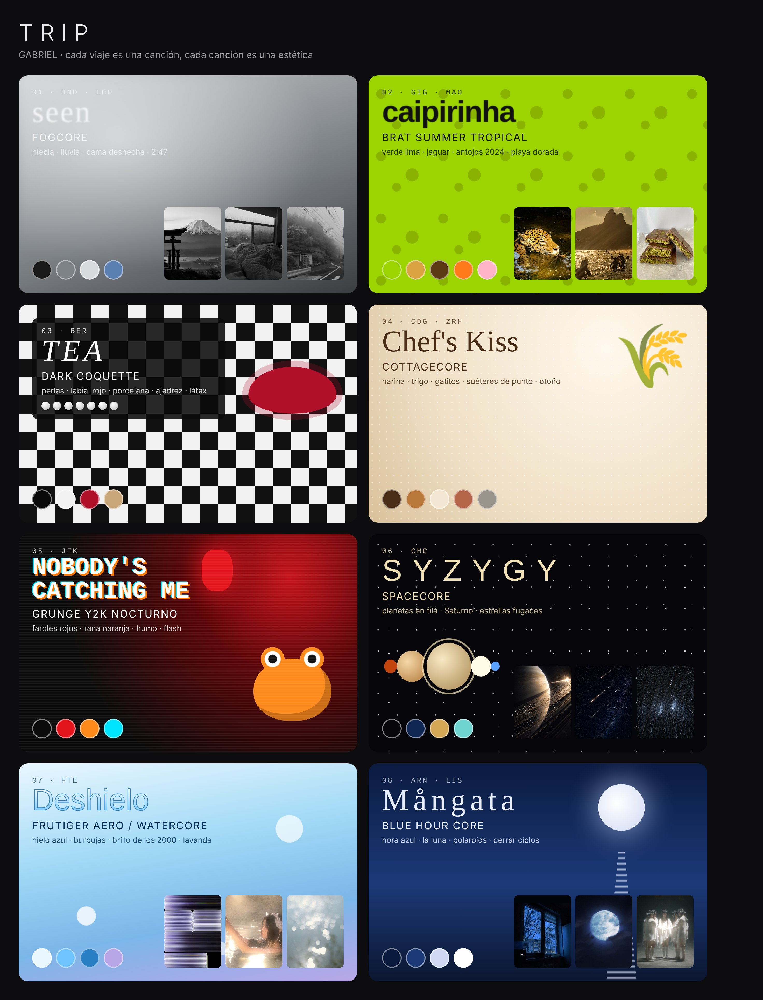
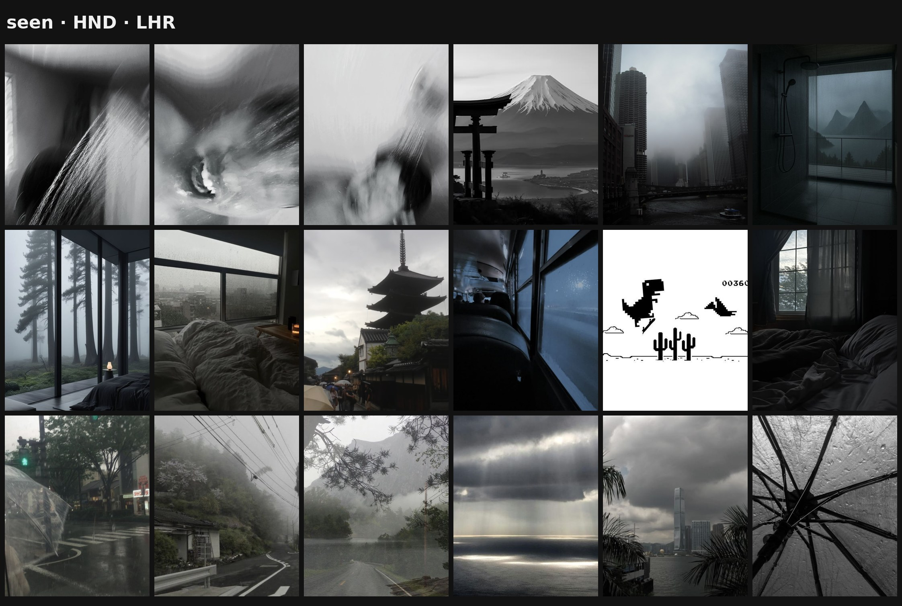
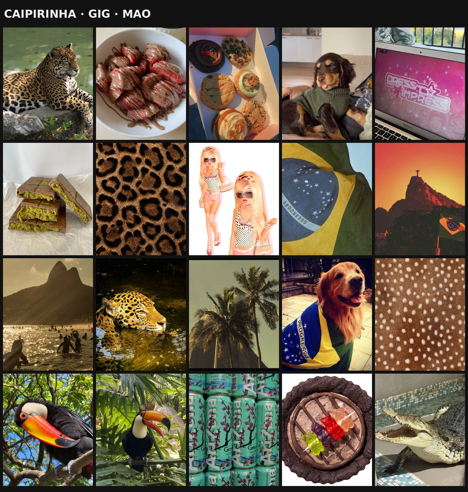
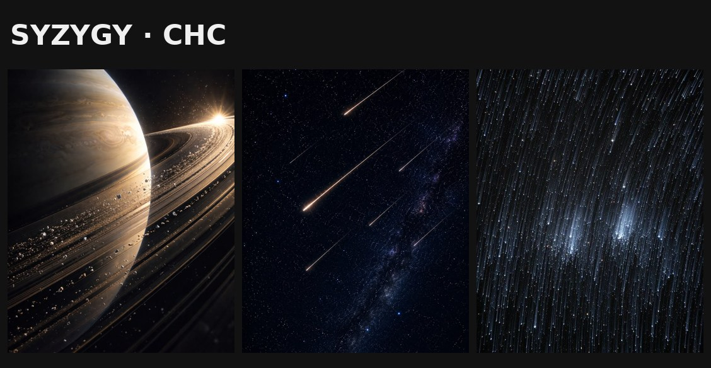
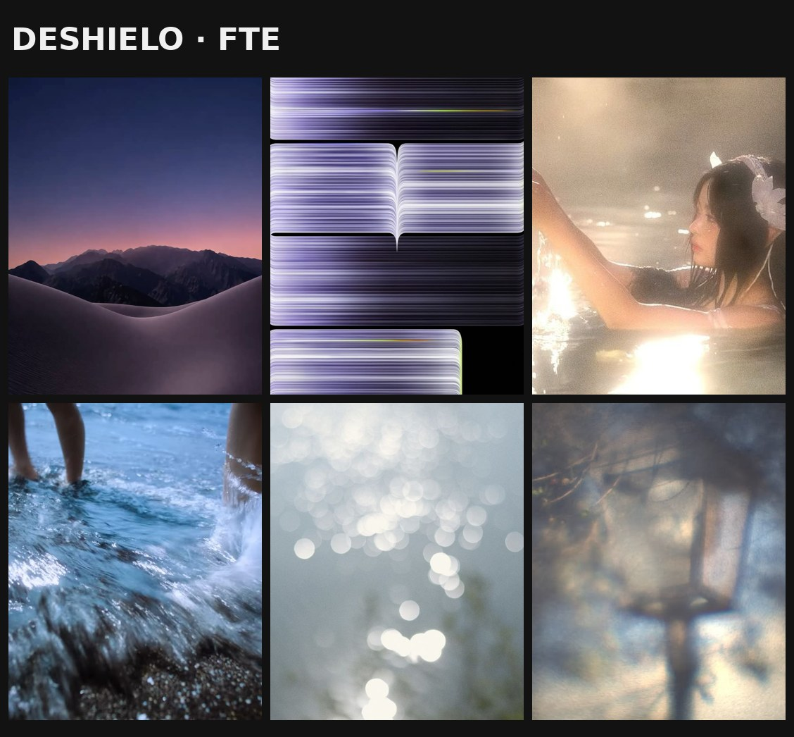
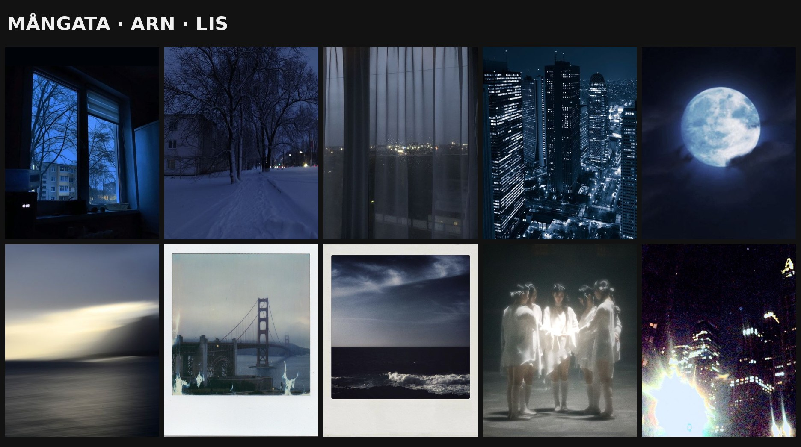

# TRIP — GABRIEL · todo el álbum

> **"Cada viaje es una canción, cada país tiene su cultura."**

Este archivo junta **todo lo trabajado**: concepto, tracklist, letras finales con traducción, producción, referencias, moodboards, video, plan de era y pendientes.
Se genera solo con `python3 tools/build_master.py`. Para editar algo, cambia el archivo de cada canción y vuelve a generarlo.

## Índice
1. [Tracklist](#tracklist)
2. [01 · Seen](#01--seen)
3. [02 · pRoPiNa](#02--propina)
4. [03 · TEA](#03--tea)
5. [04 · Chef's Kiss](#04--chef-s-kiss)
6. [05 · Nobody's Catching Me](#05--nobody-s-catching-me)
7. [06 · Syzygy](#06--syzygy)
8. [07 · Deshielo (Interlude)](#07--deshielo-interlude)
9. [08 · Mångata](#08--m-ngata)
10. [Bonus · Seen (Extended Scene)](#bonus--seen-extended-scene)
11. [Referencias de sonido y notas](#referencias-de-sonido-y-notas)
12. [Plan de era](#plan-de-era)
13. [Pendientes](#pendientes)
14. [Historial del proceso](#historial-del-proceso)

## Tracklist
| # | Canción | País | Ruta | Tema | Vibe | Calificación |
|---|---|---|---|---|---|---|
| 01 | **Seen** | 🇯🇵🇬🇧 | HND · LHR | tristeza, desvelo (single) | Fogcore | 2:54 | 8.5 |
| 02 | **pRoPiNa** | 🇧🇷🇵🇷 | GIG · MAO · SJU | fiesta en un yate por el Amazonas que se vuelve antro (Explicit) | Brat summer tropical | 6:23 | — |
| 03 | **TEA** | 🇩🇪 | BER | seducción | Dark coquette | 3:16 | 8.9 |
| 04 | **Chef's Kiss** | 🇫🇷🇨🇭🇳🇴🇮🇹 | CDG · ZRH | amor, el pan (single) | Cottagecore | 2:12 | 8.6 |
| 05 | **Nobody's Catching Me** | 🇨🇳🇺🇸 | JFK | adrenalina con amigos | Grunge Y2K nocturno | 4:09 | 8.0 |
| 06 | **Syzygy** | 🇳🇿 | CHC | los astros se alinean, desconectarte | Spacecore | 1:57 | 8.9 |
| 07 | **Deshielo (Interlude)** | 🇦🇷🇨🇦🇳🇵 | FTE | refrescar tu mente | Frutiger Aero / Watercore | 0:41 | 8.9 |
| 08 | **Mångata** | 🇸🇪🇵🇹 | ARN · LIS | hora azul, la luna: cerrar ciclos | Blue hour core | 4:50 | 9.0 |
| Bonus | Seen (Extended Scene) | 🇯🇵🇬🇧 | HND · LHR | todas las escenas extra | Fogcore | — | — |



**Duración total: 26:22** · **Álbum completo: 8.6** (calificación honesta de letra y concepto, todavía sin audio).


---

## 01 · Seen



Carpeta de imágenes: `moodboards/seen/`

### SEEN — letra FINAL v2 (Explicit)

**TRIP · Track 01 · HND · LHR · R&B soft · bedroom · 88 BPM · ~3:45**
Idioma principal: inglés (con japonés) · **Explicit**
**Vibe: fogcore**: niebla, gris, lluvia, la cama deshecha, ciudades borrosas. Todo nublado, como la cabeza a las 2:47. Sonido: R&B suave con mucha reverberación, como escuchado a través de la niebla.

**Versión clean:** `I used to sleep with my tits pressed to your back,` → `I used to sleep with my chest pressed to your back,`

```text
SEEN
TRIP · Track 01 · HND · LHR

[Intro]
Seen, seen…
kidoku, kidoku…

[Verse 1]
It's 2:47 in London and I'm still up,
refresh, refresh, refresh again,
you watched my story first tonight,
but my text is still on "delivered."
You're in Japan on the bullet train,
Mount Fuji in your window frame,
you told me you were going alone,
so who's the second coffee for?

[Pre-Chorus]
I know, I know, I'm stupid,
notifications on for you,
and every time my phone lights up,
it's never, never you…

[Chorus]
Seen, seen, you left me on seen,
seen, seen, you left me on seen,
you watch it all, you never reply,
even Fuji shows its face to the sky…
but not you, not to me.

[Verse 2]
My friends all say "just block 'em, babe,"
I tell them "tomorrow" every day,
lace bra you sent me as a joke —
wore it for nobody, sent it view-once,
you opened it in a second — and that was it,
I'm a story you skip,
a picture you don't keep.

[Pre-Chorus]
I know, I know, I'm stupid,
notifications on for you,
and every time my phone lights up,
it's never, never you…

[Chorus]
Seen, seen, you left me on seen,
seen, seen, you left me on seen,
you watch it all, you never reply,
even Fuji shows its face to the sky…
but not you, not to me.

[Post-Chorus]
Kidoku, kidoku,
ki-do-ku mu-shi,
read it, leave it,
read it, leave it,
kidoku, kidoku…

[Verse 3]
I shower just to leave my phone outside,
"go freshen up" — like I could wash you off,
the mirror fogs, your "u up?" comes back,
the water on my hips, I pretend it's you,
wine red as velvet used to run down to my abs,
now it's only water, only water,
déjà vu, déjà vu.

[Bridge]
"Mind the gap" — I'm living in it,
the Thames is gray like the ticks before they turned blue,
changing of the guard at Buckingham,
that's how fast you replaced me…
replaced me…

[Pre-Final]
I used to sleep with my tits pressed to your back,
now it's your hoodie, nothing underneath,
your perfume on the sleeves, your ashtray by the bed,
I try to undo you like a Windsor knot,
every pull, tighter, tighter…

[Final Chorus]
(just voice and piano)
Seen, seen, I'm still on seen,
seen, seen, I'm still on seen,
(everything comes back)
you watch it all, you'll never reply,
and Fuji's hiding its face from the sky…
not today.

[Post-Chorus]
Kidoku, kidoku,
ki-do-ku mu-shi,
read it, leave it,
read it, leave it,
kidoku, kidoku…

[Outro]
Sake, tequila, Bacardí,
three copas deep and still it's you,
I typed your name, deleted it,
2:47 again… again…
mata ne.
```

#### Traducción al español (para entender, no para cantar)

```text
[Intro]
Visto, visto… / kidoku, kidoku… (visto, en japonés)

[Verso 1]
Son las 2:47 en Londres y sigo despierta,
actualizar, actualizar, actualizar otra vez,
viste mi historia primero esta noche,
pero mi mensaje sigue en "entregado".
Estás en Japón en el tren bala,
el Monte Fuji en el marco de tu ventana,
me dijiste que ibas solo,
¿entonces para quién es el segundo café?

[Pre-Coro]
Ya sé, ya sé, soy tonta,
notificaciones prendidas por ti,
y cada vez que mi celular se ilumina,
nunca, nunca eres tú…

[Coro]
Visto, visto, me dejaste en visto (x2),
lo ves todo, nunca contestas,
hasta el Fuji le muestra la cara al cielo…
pero tú no, no a mí.

[Post-Coro]
Kidoku, kidoku, / kidoku mushi (dejar en visto), / léelo, déjalo, / léelo, déjalo, / kidoku, kidoku…

[Verso 2]
Mis amigas me dicen "ya bloquéalo, amiga",
yo les digo "mañana" todos los días,
el brasier de encaje que me mandaste de broma,
me lo puse para nadie y te lo mandé en foto de ver una vez,
la abriste en un segundo, y eso fue todo,
soy una historia que te saltas,
una foto que no guardas.

[Verso 3]
Me baño solo para dejar el celular afuera,
"ve a refrescarte", como si pudiera lavarte de mí,
el espejo se empaña y tu "¿estás despierta?" regresa,
el agua en mi cadera, finjo que eres tú,
vino rojo como terciopelo bajaba hasta mi abdomen,
ahora solo es agua, solo agua,
déjà vu, déjà vu.

[Puente]
"Cuidado con el hueco": vivo dentro de él,
el Támesis está gris como las palomitas antes de ponerse azules,
el cambio de guardia en Buckingham,
así de rápido me reemplazaste… me reemplazaste…

[Pre-Final]
Dormía con mis senos pegados a tu espalda,
ahora es tu hoodie, y nada debajo,
tu perfume en las mangas, tu cenicero junto a la cama,
intento desatarte como un nudo Windsor,
cada jalón, más apretado, más apretado…

[Coro Final]
Visto, visto, sigo en visto (x2),
lo ves todo, nunca vas a contestar,
y el Fuji esconde su cara del cielo…
hoy no.

[Outro]
Sake, tequila, Bacardí,
tres copas encima y sigues siendo tú,
escribí tu nombre, lo borré,
2:47 otra vez… otra vez…
mata ne (nos vemos).
```

**Pronunciación:** kidoku → ki-DÓ-ku · kidoku mushi → ki-DÓ-ku MÚ-shi · mata ne → MA-ta ne

---

## 02 · pRoPiNa



Carpeta de imágenes: `moodboards/caipirinha/`

### pRoPiNa — letra v6 (Explicit · Brasil x Puerto Rico · el yate por el Amazonas)

**TRIP · Track 02 · 🇧🇷🇵🇷 · GIG · MAO · SJU · funk carioca x dembow · verano 2024 con el corillo · sin romance · Explicit**
Estilo de **Bad Bunny** (solo inspiración: no se copia ninguna letra ni melodía).
**Idiomas (decisión de Gabriel):** ~70% español de Puerto Rico · ~20% inglés · ~10% portugués de Brasil.
**Las letras desordenadas** (mayúsculas y minúsculas mezcladas) son parte de la estética: el título y el gancho se escriben así.

```text
pRoPiNa (Explicit)
TRIP · Track 02 · BRaSiL x PuERTo RiCo

━━━━━━━━ PARTE 1 · EL YATE POR EL AMAZONAS (beat lento) ━━━━━━━━

[Intro]
(a boat engine low, water against the hull, birds, ice in a cup, a güiro)
Ey… shh… ¿escuchaste eso?
Olha só…
BRaSiL x PuERTo RiCo, baby.

[Verse 1]
(relaxed, half-sung)
Un yate cruzando el pantano, el motor en bajito,
el corillo en traje corto — casi nada, poquito,
caipirinha en una mano, piña colada en la otra,
el hielo se derrite y, acho, aquí nadie se preocupa.
Pink dolphins jumpin' right next to the boat,
guacamayos azules, un capibara de guardia,
un tucán me puso four out of ten — ¿qué te pasa, loca?
Y en la orilla, los cocodrilos… mirándonos la boca.

[Hook 1]
(soft, tipsy, the corillo singing along)
Caipirinha con piña colada,
mitad Brasil, mitad San Juan,
the sun goes down and nobody's leavin',
bora, bora — ¿y ahora pa' dónde van?

[Transition]
(the sun goes down: frogs, crickets, the river in the dark)
Se apaga el cielo, se apaga el río,
dos ojos dorados entre las hojas…
(silence)
Jaguar has en—
(the voice gets cut and stuck — 7-second mid-2000s electro synth breakdown:
a buzzing distorted synth bass, a filter sweeping up, the beat chopped and stuttering,
strobe lights flickering on the yacht, a riser climbing…)
——————————————————— (7 seg)
…the chaaaaattt.
(a growl — CLICK: neon lights flood the yacht — BOOM: brat club perreo drops)

━━━━━━━━ PARTE 2 · EL YATE SE VUELVE ANTRO (perreo + funk carioca) ━━━━━━━━

[Verse 2]
(rapped, full energy)
Se prende el neón — verde lima, verde menta,
el aire acondicionado a full y nadie se sienta,
la botella en hielo, el DJ en la proa,
solo maneja este yate en automático,
el capitán perreando como un lunático,
los chavos volando, billetes por el culo de las morras —
make it rain, make it rain, que llueva la pRoPiNa,
leopardo de pies a cabeza, chocolate de Dubái,
very demure, very mindful… ¿pa' qué? Bye.

[Chorus]
¡Vai, vai, vai! (¡wepa!)
caipirinha con piña colada,
¡vai, vai, vai! (¡wepa!)
del Amazonas a San Juan — aquí nadie dice que no,
an-an-ancla, an-an-ancla (¡ha-ha-hasta el fondo del río!)
que llueva la pRo-pRo-pRoPiNa — this summer's on me.

[Post-Chorus]
(group chant)
Ei, ei, ei — el yate no se para,
ei, ei, ei — the party never stops,
ei, ei, ei — mais uma, mais uma,
ei, ei, ei — ¡pRoPiNa!

[Verse 3]
El corillo se tira al agua con los cocodrilos,
nadando en círculos, borrachos y tranquilos,
les servimos caipirinha y se ríen los cabrones,
un caimán con shades pidiendo otra ronda,
funk de Río con perreo de la isla en la misma onda,
four a.m. and nobody's checkin' the time,
que delícia, Brasil — esto está brutal, mi pana.

[Rap]
(cocky, glitchy, half-whispered over the beat)
In-in-intoxicated, el yate da vueltas,
look, my thong — leopardo, que se vea la tela,
ella tiene un tattoo inside her lip,
lo enseña cuando se ríe — pRoPiNa, drip, drip,
el aire acondicionado y yo sudando igual,
el jaguar en mi piel — esto ya no es normal,
billetes en el río, cocodrilos con shades,
in-in-intoxicated… (glitch) …no me busques mañana.

[Glitch Break]
(the beat freezes like a skipping CD — strobe lights — then stutters back in, chopped and stuck)
Lu-lu-luces, lu-lu-luces,
los nenes bajo ti, bajo ti, bajo ti,
pRo- pRo- pi- pi- na, pRo- pRo- pi- pi- na,
al suelo, al suelo — perreo duro al suelo,
lu-lu-luces… (stop)
…¡pRoPiNa!
(BOOM — everything back at full power)

[Final Chorus]
¡Vai, vai, vai! (¡wepa!)
caipirinha con piña colada,
¡vai, vai, vai! (¡wepa!)
del Amazonas a San Juan — aquí nadie dice que no,
an-an-ancla, an-an-ancla (¡ha-ha-hasta el fondo del río!)
que llueva la pRo-pRo-pRoPiNa — this summer's on me.

[Post-Chorus]
Ei, ei, ei — el yate no se para,
ei, ei, ei — the party never stops,
ei, ei, ei — mais uma, mais uma,
ei, ei, ei — ¡pRoPiNa!

[Drop Final]
(everything cuts except the kick and the corillo clapping… a snare roll, a riser climbing…)
¿Están listos? — ¡más volumen!
(BOOM — the beat doubles: hypnotic, distorted Brazilian funk, the bass hits your chest)
An-an-ancla, an-an-ancla — ¡pRoPiNa!
an-an-ancla, an-an-ancla — ¡pRoPiNa!
la cintura se me va, la cintura se me va,
la cintura se me va… (¡wepa!)
mais uma, mais uma, mais uma — ¡ancla!
(corillo) ¡Más volumen! ¡Más volumen!
an-an-ancla, an-an-ancla — ¡pRoPiNa!
la cintura se me va… se me va… se me va…

[Glitch Ending]
(the beat starts skipping and breaking apart)
In-in-in-intoxi— in-in— in—
(tape stop — silence)

[Outro]
(sunrise — the beat cuts. Birds. The yacht drifting. A cuatro puertorriqueño alone.)
Se prenden las luces del cielo…
los cocodrilos dormidos en la orilla…
Obrigada, Lima…
obrigada, Brasil…
y Puerto Rico… gracias por venir.
Tudo bem…
see you next summer.
(a lime squeezed one last time)
```

#### El título: pRoPiNa
Los billetes que llueven en el antro del yate, y la actitud de ella: *"este verano lo pago yo"*. Ella paga, ella deja la propina, ella manda. Se escribe con las letras desordenadas: **pRoPiNa** (alternada de principio a fin). Sin tildes ni "ñ".

#### Referencias del club (Parte 2)
SaWaDiKa (LISA, 2026) · Tarde (Kenia Os, 2026), su final glitcheado · Power Trip (JENNIE), la parte del rap y el final · Guess (Charli XCX con Billie Eilish) · Club classics (Charli XCX) · EoO (Bad Bunny). Solo inspiración: no se copia letra, melodía ni sample.
- **Rap de canto pegajoso** que se repite como cántico (estilo SaWaDiKa).
- **Perreo duro hasta el suelo**, rap bailable (estilo la parte del rap de Power Trip).
- **Glitcheado y trabado:** el beat se congela como CD rayado y regresa cortado; voces picadas y repetidas ("an-an-ancla", "pRo-pRo-pRoPiNa", "lu-lu-luces"), luces estroboscópicas (estilo Club classics).
- **El final** con un cambio fuerte, como el cierre de Tarde.

#### "Ancla" (el perreo del yate)
En lugar de "baja hasta el suelo": **tírate como ancla**. El cuerpo baja perreando como el ancla del yate que cae hasta el fondo del río. Paso de baile: bajar de golpe al suelo cuando suena "¡hasta el fondo del río!".

#### El rap (frases de Gabriel)
*"Intoxicated"*, *"look, my thong"* y *"tattoo inside her lip"*: inglés atrevido, picado y glitcheado, en un rap medio susurrado con actitud. El tatuaje por dentro del labio es real (se ve solo cuando se baja el labio o cuando se ríe).

#### El Drop Final (la parte que te obliga a subirle el volumen)
Lo que hace que no puedas dejar de moverte:
1. **Todo se corta** menos el bombo y las palmas del corillo: tensión.
2. **Redoble y riser** que suben… *"¿Están listos? — ¡más volumen!"*
3. **El beat se duplica:** de perreo a **funk brasileño hipnótico y distorsionado** (como el funk automotivo de Brasil), con un bajo que se siente en el pecho.
4. **Un loop cortito repetido muchas veces** ("an-an-ancla — ¡pRoPiNa!"): la repetición es lo que hipnotiza el cuerpo.
5. **"La cintura se me va"**: la sensación de que la cintura desaparece de tanto perrear.
6. **Llamada y respuesta** con el corillo (*"¡más volumen!"*) para que el público grite.

#### La historia
Un **yate por el Amazonas** con el corillo, todos en traje corto, casi sin ropa, y una fiesta que se va emborrachando entre cocodrilos, delfines rosados, guacamayos azules y un capibara. Se mete el sol, aparece el jaguar y **se prende el neón: el yate se vuelve antro**. Verde lima y verde menta, aire acondicionado a todo, billetes volando y propina para las bailarinas. Al final, la gente nadando con los cocodrilos "borrachos" hasta el amanecer.

#### La estructura (cambio de ritmo a mitad de canción)
- **Parte 1 · El yate:** beat lento, guitarra de bossa, agua, pájaros. La fiesta empieza tranquila.
- **La transición:** se apaga el cielo, el jaguar, silencio… **CLICK** (se prenden las luces de neón) y **BOOM** (entra el beat de club).
- **Parte 2 · El antro en el yate:** perreo + funk carioca, para alocarte.
- **Outro:** amanece, se corta el beat; los cocodrilos dormidos en la orilla.

#### Para el video (importante)
- **Nada de animales reales con alcohol ni gente nadando con cocodrilos reales**: todo con animación o efectos (como el arte del cocodrilo morado de tu moodboard). Así se ve de caricatura y no hay riesgo.
- Todas las personas del video, **mayores de edad**. La parte del antro puede tener una versión del video con más censura para las plataformas.

#### Palabras de Puerto Rico y Brasil
| Palabra | De dónde | Significa |
|---|---|---|
| corillo | 🇵🇷 | el grupo de amigos |
| ¡wepa! | 🇵🇷 | grito de alegría |
| quemao' / mezclao' / to'a | 🇵🇷 | quemado / mezclado / toda (así se habla en la isla) |
| piña colada | 🇵🇷 | bebida nacional de Puerto Rico (nació en San Juan) |
| vai | 🇧🇷 | ¡vamos! |
| golazo / Neymar | 🇧🇷 | el fútbol de Brasil |
| chavos | 🇵🇷 | dinero |
| acho | 🇵🇷 | muletilla boricua (como "wey" o "bro") |
| brutal / mi pana | 🇵🇷 | increíble / mi amigo |
| olha só | 🇧🇷 | ¡mira nada más! |
| bora | 🇧🇷 | ¡vámonos! |
| mais uma | 🇧🇷 | ¡otra más! |
| que delícia | 🇧🇷 | ¡qué rico! |
| tudo bem | 🇧🇷 | todo bien |
| tacacá con jambú | 🇧🇷 | sopa del Amazonas; el jambú adormece la boca |
| capoeira / berimbau | 🇧🇷 | arte marcial con música / su instrumento de una cuerda |
| cuatro puertorriqueño | 🇵🇷 | la guitarrita típica de Puerto Rico |
| plena | 🇵🇷 | ritmo de tambores de mano de Puerto Rico |

#### La historia
El corillo viaja por Brasil en el verano de 2024, y una del grupo es **boricua**: trae su forma de hablar, sus gritos y la piña colada. Por eso el vaso mezcla las dos islas: **caipirinha con piña colada**. Sin romance: Lima solo aparece como el que mete el gol.

#### Producción (Brasil x Puerto Rico · dos beats)
- **Parte 1 (~88 BPM):** guitarra de bossa, cuíca suave, güiro, pájaros y lluvia de fondo; voz relajada, medio cantada.
- **Transición (el cambio de traba):** naturaleza (lluvia, ranas, grillos), silencio… *"Jaguar has en—"* se corta y se traba, y entran **7 segundos de breakdown electro de mediados de los 2000**: bajo de sinte zumbado y distorsionado, filtro que sube, beat picado y tartamudeando, luces estroboscópicas, un riser que sube… *"…the chaaaaattt"* estirado, el rugido, y explota el **perreo de club brat**.
- **Parte 2 (~100 BPM):** **funk carioca + dembow**, bajo pesado, sintes de neón; voz rapeada con energía; coro y post-coro para gritar en grupo.
- **Glitch Break:** el beat se congela y tartamudea (stutter edits, cortes de cinta, voces picadas), luces estroboscópicas, y regresa todo de golpe para el coro final.
- **Outro:** se corta el beat; pájaros, olas y el **cuatro puertorriqueño** solo.

Prompt de estilo: `two-part Brazil x Puerto Rico summer song, part one slow bossa guitar with soft cuíca, güiro, jungle birds and rain, relaxed half-sung vocals, transition with rain and frogs, then a cut-off stuttering vocal into a 7-second mid-2000s electro house synth breakdown with buzzing distorted saw bass, filter sweep, chopped stuttering beat and a riser, then a stretched vocal and a jaguar growl, then a hard beat switch into a brat-style club perreo: a neon club banger mixing Brazilian funk carioca and reggaeton dembow, heavy bass, chanty rapped Spanish vocals, glitchy stutter edits, chopped stuck vocals, beat freezes like a skipping CD, hard perreo, group chants, final drop where everything cuts to kick and claps, snare roll and riser, then a double-time hypnotic distorted Brazilian funk drop with chest-hitting sub bass and a short chant loop repeated, outro with birds, waves and a Puerto Rican cuatro`

#### Tendencias 2024 en la letra
POV · aura (+1000 aura) · "very demure, very mindful" (con un "No") · dress to impress · brain rot (palabra del año 2024) · gatekeeping · unbothered · "___ has entered the chat" · group chat · animal print, verde lima, chocolate de Dubái, Brazilcore (camiseta de Brasil).

**Pronunciación:** caipirinha → kai-pi-RI-nya · vai → VAI ("¡vamos!") · brigadeiro → bri-ga-DÉI-ru · tacacá → ta-ka-KÁ · jambu → zham-BÚ · berimbau → be-rim-BÁU · obrigada → o-bri-GA-da


#### Historial: versión v5 (del Amazonas al club)
```text
[TÍTULO POR DECIDIR]
TRIP · Track 02 · BRaSiL x PuERTo RiCo

━━━━━━━━ PARTE 1 · EL AMAZONAS (beat lento) ━━━━━━━━

[Intro]
(a lime crushed, ice in a cup, a güiro, birds, a cuíca far away)
Ey… shh… ¿escuchaste eso?
BRaSiL x PuERTo RiCo.

[Verse 1]
(relaxed, half-sung)
Camiseta de Brasil, dos tallas de más,
un cachete quemao' y no pienso parar,
Lima se tira un Neymar en la arena — ¡golazo!
y el Cristo con los brazos como guardándonos el lugar.
Avioneta pa' Manaos, seis en una canoa,
un tucán me puso cuatro de diez — ¿qué te pasa, loca?
Tres guacamayos gritando como un grupo de chat,
un caimán ni me mira, ya lo ha visto to'a,
tacacá con jambú, se nos duerme la boca.

[Hook 1]
(soft, the corillo singing along)
Caipirinha con piña colada,
mitad Brasil, mitad San Juan,
el sol se va y no pasa nada…
el corillo pregunta: "¿y ahora pa' dónde van?"

[Transition]
(everything drops: rain, frogs, crickets, six hammocks creaking)
Seis hamacas y nadie duerme,
capoeira en el lodo, un berimbau en lo oscuro,
dos ojos dorados entre las hojas…
(silence)
jaguar has entered the chat.
(a growl — BOOM: the club beat drops)

━━━━━━━━ PARTE 2 · EL CLUB (perreo + funk carioca) ━━━━━━━━

[Verse 2]
(rapped, full energy)
Luz lila, luz limón, la botella en hielo,
leopardo de pies a cabeza, no toco el suelo,
very demure, very mindful… ¿pa' qué? ¡No!
me vestí pa' impresionar, me pasé, y me encantó,
chocolate de Dubái en la mesa, el corillo en el sillón,
billetes en el piso como hojas en el río,
el jaguar soy yo — y la pista es territorio mío.

[Chorus]
¡Vai, vai, vai! (¡wepa!)
caipirinha con piña colada,
¡vai, vai, vai! (¡wepa!)
de Río a San Juan — aquí nadie dice que no,
suelta, suelta, suelta (¡hasta abajo!)
este verano lo pago yo.

[Post-Chorus]
(group chant)
Ei, ei, ei — de Río a San Juan,
ei, ei, ei — el corillo no se va,
ei, ei, ei — una más, una más,
ei, ei, ei — ¡wepa!

[Verse 3]
Funk de Río con perreo de la isla,
la cuíca y el güiro peleando en la misma pista,
el DJ grita "¡Brasil!", el corillo grita "¡Boricua!",
y yo en el medio con la caipirinha en la mano, ¿y tú?
Las cuatro de la mañana y nadie mira la hora,
la playa está esperando, pero la noche no se demora.

[Chorus]
¡Vai, vai, vai! (¡wepa!)
caipirinha con piña colada,
¡vai, vai, vai! (¡wepa!)
de Río a San Juan — aquí nadie dice que no,
suelta, suelta, suelta (¡hasta abajo!)
este verano lo pago yo.

[Post-Chorus]
Ei, ei, ei — de Río a San Juan,
ei, ei, ei — el corillo no se va,
ei, ei, ei — una más, una más,
ei, ei, ei — ¡wepa!

[Outro]
(5 a.m. — the beat cuts. Birds again. A cuatro puertorriqueño alone. Waves.)
Se prenden las luces…
afuera ya cantan los pájaros…
Obrigada, Lima…
obrigada, Brasil…
y Puerto Rico… gracias por venir.
(a lime squeezed one last time)
```

##### La estructura (como un cambio de ritmo a mitad de canción)
- **Parte 1 · El Amazonas:** beat lento y relajado. Guitarra de bossa, percusión suave, pájaros, lluvia. El día: la playa, el Neymar, la canoa, el tucán, el jambú.
- **La transición:** todo se apaga. Lluvia, ranas, seis hamacas, el berimbau… silencio… *"jaguar has entered the chat"*, el rugido y **¡BOOM!** entra el beat de club.
- **Parte 2 · El club:** perreo + funk carioca, neón lila y verde lima, billetes, botellas en hielo, el corillo. Para alocarte.
- **El outro** regresa a la naturaleza: se acaba la fiesta, salen los pájaros. La canción empieza y termina en la selva.
- **Detalle escondido:** *"billetes en el piso como hojas en el río"*: el club repite la imagen del Amazonas.


#### Historial: versión v4 (Brasil x Puerto Rico, un solo beat)
```text
CAiPiRiNHa
TRIP · Track 02 · BRaSiL x PuERTo RiCo

[Intro]
(a lime being crushed, ice hitting a cup, a güiro scraping, a cuíca squeak)
Ey… ey…
De Río pa' San Juan, ¿me escuchaste?
BRaSiL x PuERTo RiCo, bebé.

[Verse 1]
Camiseta de Brasil, dos tallas de más,
un cachete quemao' y no pienso parar,
el Cristo con los brazos como guardándonos el lugar,
Lima se tira un Neymar y el corillo a gritar — ¡golazo!
Todo de leopardo, chocolate de Dubái,
me vestí pa' impresionar y me pasé… ¿y qué? Bye.
Very demure, very mindful… ¿pa' qué?
Estoy en mi era del 2024, verde lima, ¿tú me ves?

[Chorus]
CAiPiRiNHa, CAiPiRiNHa (¡wepa!)
limón, azúcar, hielo — y otra vez, mi amiga,
CAiPiRiNHa con piña colada (¡vai, vai!)
de Río a San Juan — aquí nadie dice que no.

[Post-Chorus]
Vai, vai, vai (¡dale!)
vai, vai, vai (¡dale!)
portugués y boricua mezclao' en un vaso,
vai, vai, vai — este verano lo pago yo.

[Verse 2]
Avioneta pa' Manaos, seis en una canoa,
un tucán me puso cuatro de diez — ¿qué te pasa, loca?
Tres guacamayos gritando como un grupo de chat,
un caimán ni me mira, ya lo ha visto to'a,
tacacá con jambú, se nos duerme la boca,
brain rot total, cantando el coro a lo loco.

[Chorus]
CAiPiRiNHa, CAiPiRiNHa (¡wepa!)
limón, azúcar, hielo — y otra vez, mi amiga,
CAiPiRiNHa con piña colada (¡vai, vai!)
de Río a San Juan — aquí nadie dice que no.

[Post-Chorus]
Vai, vai, vai (¡dale!)
vai, vai, vai (¡dale!)
portugués y boricua mezclao' en un vaso,
vai, vai, vai — este verano lo pago yo.

[Bridge]
(beat switch: plena drums meet a berimbau, rain on the leaves)
Capoeira en el lodo, un berimbau en lo oscuro,
este sitio lo guardamos — sin pin, sin post, sin mapa,
seis hamacas y nadie duerme,
dos ojos dorados entre las hojas…
jaguar has entered the chat.
(a low growl — the funk drum slams back in)

[Final Chorus]
CAiPiRiNHa, CAiPiRiNHa (¡wepa!)
limón, azúcar, hielo — y otra vez, mi amiga,
CAiPiRiNHa con piña colada (¡vai, vai!)
de Río a San Juan — aquí nadie dice que no.

[Post-Chorus]
Vai, vai, vai (¡dale!)
vai, vai, vai (¡dale!)
portugués y boricua mezclao' en un vaso,
vai, vai, vai — este verano lo pago yo.

[Outro]
(the beat fades: a cuatro puertorriqueño alone, waves, the corillo laughing far away)
Obrigada, Lima…
obrigada, Brasil…
y Puerto Rico… gracias por venir.
Que este verano no se acabe nunca…
CAiPiRiNHa.
```


#### Historial: versión anterior (v3, en inglés)
```text
CAIPIRINHA
TRIP · Track 02

[Intro]
(a lime being crushed, ice hitting a cup, a cuíca squeak)
POV: Brasil.

[Verse 1]
Cristo's got his arms out like he's saving us a seat,
Brazil jersey two sizes too big, a sunburn on one cheek,
black-and-white waves on the sidewalk under bare feet,
Lima pulls a Neymar — plus a thousand aura, sweet.

[Pre-Chorus]
Very demure? Very mindful? No — next,
I'm in my '24 era, lime-green like XCX,
dressed to impress — and it's way too much…
good. That's the point. Here we go —

[Chorus]
Cai-pi, cai-pi, caipirinha (ei!)
spots on my skin, I'm wild for the summer,
cai-pi, cai-pi, caipirinha (ei!)
claws out — louder, louder,
cut it, crush it, ice it, shake it,
lime-green summer, nobody can fake it,
cai-pi, cai-pi, caipirinha (ei!)
Rio to Manaus — nobody says no.

[Post-Chorus]
Vai, vai, vai! (caipirinha!)
Vai, vai, vai! (caipirinha!)
one more round — and repeat,
vai, vai, vai! — this summer's on me.

[Verse 2]
Tiny plane to Manaus, six of us in one canoe,
a toucan rates my outfit — four out of ten? Rude.
Three macaws splashing like a group chat going off,
a caiman's eye unbothered, like he's seen enough,
tacacá with jambu, mouths go numb — total brain rot,
we try to sing the chorus, it's the best one that we've got.

[Pre-Chorus]
Very demure? Very mindful? No.
Leopard everything, Dubai chocolate, let it show,
dressed to impress — and it's way too much…
good. That's the point. Here we go —

[Chorus]
Cai-pi, cai-pi, caipirinha (ei!)
spots on my skin, I'm wild for the summer,
cai-pi, cai-pi, caipirinha (ei!)
claws out — louder, louder,
cut it, crush it, ice it, shake it,
lime-green summer, nobody can fake it,
cai-pi, cai-pi, caipirinha (ei!)
Rio to Manaus — nobody says no.

[Post-Chorus]
Vai, vai, vai! (caipirinha!)
Vai, vai, vai! (caipirinha!)
one more round — and repeat,
vai, vai, vai! — this summer's on me.

[Bridge]
(the beat drops: rain, a berimbau, crickets)
Capoeira in the mud, a berimbau in the dark,
we're gatekeeping this place — no pins, no posts, no maps,
six hammocks, nobody sleeps,
two golden eyes between the leaves…
jaguar has entered the chat.
(a low growl — the drum slams back in)

[Final Chorus]
Cai-pi, cai-pi, caipirinha (ei!)
spots on my skin, I'm wild for the summer,
cai-pi, cai-pi, caipirinha (ei!)
claws out — louder, louder,
cut it, crush it, ice it, shake it,
lime-green summer, nobody can fake it,
cai-pi, cai-pi, caipirinha (ei!)
Rio to Manaus — nobody says no.

[Post-Chorus]
Vai, vai, vai! (caipirinha!)
Vai, vai, vai! (caipirinha!)
one more round — and repeat,
vai, vai, vai! — this summer's on me.

[Outro]
(the drum fades, a lime squeezed one last time)
Obrigada, Lima…
obrigada, Brasil…
caipirinha.
```

##### Traducción al español (para entender)

```text
[Intro]
POV: Brasil.

[Verso 1]
El Cristo tiene los brazos abiertos como si nos apartara un lugar,
camiseta de Brasil dos tallas más grande, quemada de sol en una sola mejilla,
las olas blancas y negras de la banqueta bajo los pies descalzos,
Lima se avienta un Neymar: más mil de aura, qué rico.

[Pre-Coro]
¿Muy discreta? ¿Muy prudente? No… siguiente,
estoy en mi era del 2024, verde lima como XCX,
me arreglé para impresionar… y es demasiado.
Bien. Esa es la idea. Ahí vamos…

[Coro]
Cai-pi, cai-pi, caipiriña (¡ey!)
manchas en mi piel, salvaje por el verano,
cai-pi, cai-pi, caipiriña (¡ey!)
garras fuera, más fuerte, más fuerte,
córtalo, machácalo, ponle hielo, agítalo,
verano verde lima, nadie lo puede fingir,
cai-pi, cai-pi, caipiriña (¡ey!)
de Río a Manaos, nadie dice que no.

[Post-Coro]
¡Vamos, vamos, vamos! (¡caipiriña!)
¡Vamos, vamos, vamos! (¡caipiriña!)
otra ronda… y otra vez,
¡vamos, vamos, vamos! Este verano lo pago yo.

[Verso 2]
Avioneta a Manaos, seis de nosotros en una canoa,
un tucán califica mi outfit: ¿cuatro de diez? Grosero.
Tres guacamayas chapoteando como un chat de grupo que no para,
el ojo de un caimán, indiferente, como si ya hubiera visto suficiente,
tacacá con jambu, se nos duerme la boca: cerebro frito total,
intentamos cantar el coro, es lo mejor que tenemos.

[Pre-Coro 2]
¿Muy discreta? ¿Muy prudente? No.
Leopardo en todo, chocolate de Dubái, que se note,
me arreglé para impresionar… y es demasiado.
Bien. Esa es la idea. Ahí vamos…

[Puente]
Capoeira en el lodo, un berimbau en la oscuridad,
le guardamos el secreto a este lugar: sin ubicación, sin posts, sin mapas,
seis hamacas, nadie duerme,
dos ojos dorados entre las hojas…
el jaguar se unió al chat.

[Outro]
Gracias, Lima…
gracias, Brasil…
caipiriña.
```

##### El coro nuevo (v3)
- **"Cai-pi, cai-pi, caipirinha"**: el título partido en sílabas que rebotan; se canta aunque no sepas inglés.
- **"(ei!)"**: el grito de grupo después de cada "caipirinha".
- **"cut it, crush it, ice it, shake it"**: la receta real de la caipirinha (cortar el limón, machacarlo con azúcar, hielo, agitar) convertida en **cuatro pasos de baile** para TikTok.

---

## 03 · TEA

### TEA — letra (v11: máximo sexual, rara, estilo SOPHIE) · Explicit

**TRIP · Track 03 · 🇩🇪 Germany · R&B elegante + hyperpop plástico · ~2:50**
Elegante por fuera; látex, porcelana y vapor por dentro. Rara a propósito.

```text
TEA (Explicit)
TRIP · Track 03

[Intro]
(a porcelain cup squeaks like rubber. steam hisses, pitched up.)
(pitched, robotic)
Hot. Wet. Sweet. Steep.
Hot. Wet. Sweet. Steep.

[Chorus]
(a cup slammed on a saucer, on the beat)
I love making this TEA-TEA-TEA,
sugar cracking, only just for me-me-me,
whipped cream clouds — squeeze-squeeze-squeeze,
cinnamon breeze down to my knees-knees-knees,
espresso shot, secret receipt — for me-me-me,
(spell it!) T-E-A, (again!) T-E-A,
I love making this TEA-TEA-TEA.

[Verse 1]
Black dress, white pearls, nothing underneath,
porcelain legs on the checkered floor, pearls between my teeth,
I cross 'em, uncross 'em — he spills the milk, he blames the cup,
"How do you take it?" — "Hot. Wet. Filled right up."
"You're not gonna stir it?" — "No. You stir me."
"You always listen to strangers?" — "Only when they're on their knees."

[Pre-Chorus]
He brings the check face down, flour on his hand,
check. Your move. Lick it off — understand?
Hot, hot, hot — don't blow on it,
hot, hot, hot — put your mouth on it.

[Chorus]
I love making this TEA-TEA-TEA,
sugar cracking, only just for me-me-me,
whipped cream clouds — squeeze-squeeze-squeeze,
cinnamon breeze down to my knees-knees-knees,
espresso shot, secret receipt — for me-me-me,
(spell it!) T-E-A, (again!) T-E-A,
I love making this TEA-TEA-TEA.

[Post-Chorus]
(chopped, squeaky, plastic — the part that won't leave your head)
In, out, in, out (tea, tea, tea),
dip it, dip it, drip it all on me, me, me,
in, out, let it steep (tea, tea, tea),
three minutes in, and he's all me.

[Verse 2]
He never asks me what I want, he pours me what I need,
holds the pot up high so I can watch it stream,
a warm Brötchen in his palm — "squeeze it, it's on me" —
lipstick on the rim, lipstick on his collar, let the whole café see.
"Milk first or after?" — "After. Always after. Then again."
Thursday I brought my friends — "Who's the chef? Who made this?"
I just lick the spoon… and I let them guess.
(the camera holds on his cup, the hot water turning amber)
He walked in clear like water —
now he's my color, my flavor, my name.

[Pre-Chorus 2]
Come and taste this tea,
put your lips where my lipstick used to be,
burn your tongue a little — that's the fee,
don't pull it out too soon… let it steep in me.

[Chorus]
I love making this TEA-TEA-TEA,
sugar cracking, only just for me-me-me,
whipped cream clouds — squeeze-squeeze-squeeze,
cinnamon breeze down to my knees-knees-knees,
espresso shot, secret receipt — for me-me-me,
(spell it!) T-E-A, (again!) T-E-A,
I love making this TEA-TEA-TEA.

[Post-Chorus]
In, out, in, out (tea, tea, tea),
dip it, dip it, drip it all on me, me, me,
in, out, let it steep (tea, tea, tea),
three minutes in, and he's all me.

[Bridge]
(everything goes plastic: the spoon on the cup sped up into a machine)
"You know what the spoon means?" — "Tell me. I'm all ears."
"If you leave it in, you're done." — "Then, chef… leave it right here."
Sugar cube on my tongue — watch it melt, watch it go,
I suck the honey off the spoon — he drops the tray, porcelain everywhere.
Sugar on my ass — suck it off, every grain.
(pitched up, almost a machine)
Hot. Wet. Sweet. Steep.
Crack me like a sugar cube.
Hot. Wet. Sweet. Steep.
Pour. Pour. Pour.
I never, never leave it in…
(silence)
…unless you ask me nice.

[Final Chorus]
(everything slams back in)
I love making this TEA-TEA-TEA,
sugar cracking, only just for me-me-me,
whipped cream clouds — squeeze-squeeze-squeeze,
cinnamon breeze down to my knees-knees-knees,
espresso shot, secret receipt — for me-me-me,
(spell it!) T-E-A, (again!) T-E-A,
okay, okay, I'll spill the tea:
the last receipt just says "come with me."
T-E-A.

[Post-Chorus]
In, out, in, out (tea, tea, tea),
dip it, dip it, drip it all on me, me, me,
hot, hot, hot (tea, tea, tea),
don't blow on it — come to me.

[Outro]
(his voice, soft, almost whispered)
"Flip it over…"
"…viens avec moi."
(you smile, slide your sunglasses back on)
sip…
(the cup squeaks one last time)
checkmate.
```

#### Traducción al español (para entender, no para cantar)

```text
[Intro]
Caliente. Mojado. Dulce. Reposando. (x2)

[Coro]
Me encanta preparar este TÉ-TÉ-TÉ,
el azúcar crujiendo, solo para mí-mí-mí,
nubes de crema batida: aprieta, aprieta, aprieta,
una brisa de canela que me baja hasta las rodillas,
un shot de espresso, un recibo secreto, para mí-mí-mí,
(¡deletréalo!) T-E-A, (¡otra vez!) T-E-A,
me encanta preparar este TÉ-TÉ-TÉ.

[Verso 1]
Vestido negro, perlas blancas, nada debajo,
piernas de porcelana en el piso de ajedrez, perlas entre los dientes,
las cruzo, las descruzo; a él se le cae la leche y le echa la culpa a la taza,
"¿Cómo lo tomas?" — "Caliente. Mojado. Bien lleno."
"¿No lo vas a revolver?" — "No. Revuélveme tú a mí."
"¿Siempre le haces caso a desconocidos?" — "Solo cuando están de rodillas."

[Pre-Coro]
Trae la cuenta boca abajo, con harina en la mano,
jaque. Te toca. Lámela, ¿entiendes?
Caliente, caliente, caliente: no le soples,
caliente, caliente, caliente: ponle la boca.

[Post-Coro]
Adentro, afuera, adentro, afuera (té, té, té),
mójalo, mójalo, escúrrelo todo sobre mí, mí, mí,
adentro, afuera, déjalo reposar (té, té, té),
tres minutos dentro, y ya es todo mío.

[Verso 2]
Nunca me pregunta qué quiero, me sirve lo que necesito,
levanta la tetera alto para que lo vea caer en chorro,
un Brötchen calientito en su mano: "apriétalo, yo invito",
labial en el borde, labial en su cuello de camisa, que lo vea todo el café.
"¿La leche antes o después?" — "Después. Siempre después. Y otra vez."
El jueves traje a mis amigas: "¿Quién es el chef? ¿Quién hizo esto?"
Yo solo lamo la cuchara… y dejo que adivinen.
(la cámara se queda en su taza, el agua volviéndose ámbar)
Él entró transparente como el agua;
ahora tiene mi color, mi sabor, mi nombre.

[Pre-Coro 2]
Ven y prueba este té,
pon tus labios donde estuvo mi labial,
quémate un poco la lengua, ese es el precio,
no la saques tan pronto… déjala reposar en mí.

[Puente]
"¿Sabes qué significa la cuchara?" — "Dime. Soy todo oídos."
"Si la dejas dentro, ya terminaste." — "Entonces, chef… déjala aquí."
Un terrón de azúcar en mi lengua: mira cómo se derrite, cómo se va,
chupo la miel de la cuchara y a él se le cae la charola: porcelana por todos lados.
Azúcar en mi trasero: chúpala toda, hasta el último grano.
Caliente. Mojado. Dulce. Reposando.
Rómpeme como un terrón de azúcar.
Caliente. Mojado. Dulce. Reposando.
Sirve. Sirve. Sirve.
Nunca, nunca la dejo dentro…
…a menos que me lo pidas bonito.

[Coro Final]
Me encanta preparar este TÉ-TÉ-TÉ,
el azúcar crujiendo, solo para mí-mí-mí,
nubes de crema batida: aprieta, aprieta, aprieta,
una brisa de canela que me baja hasta las rodillas,
un shot de espresso, un recibo secreto, para mí-mí-mí,
(¡deletréalo!) T-E-A, (¡otra vez!) T-E-A,
está bien, está bien, voy a soltar el chisme:
el último recibo solo dice "ven conmigo".
T-E-A.

[Post-Coro Final]
Adentro, afuera, adentro, afuera (té, té, té),
mójalo, mójalo, escúrrelo todo sobre mí, mí, mí,
caliente, caliente, caliente (té, té, té),
no le soples: ven a mí.

[Outro]
"Voltéalo…" / "…ven conmigo." (viens avec moi) / sorbo… / jaque mate.
```

**Juegos de palabras:** "spill the tea" = contar el chisme · "check" = la cuenta y "jaque" · "steep" = dejar reposar (suena a *deep*, profundo) · "in, out" = meter y sacar la bolsita de té… o no.

#### Producción: rara como SOPHIE (inspiración, sin copiar)
- **Choque de mundos:** versos de R&B elegante y suave contra coros y post-coros de **hyperpop plástico**: ahí está lo raro.
- **Sonidos del café convertidos en sintes:** la taza que **rechina como látex**, la cuchara contra la porcelana acelerada hasta sonar a máquina, vapor que silba con tono, azúcar crujiendo en primer plano (ASMR).
- **Bajo de goma**, golpes metálicos secos, silencios totales antes de que todo regrese de golpe.
- **Voces:** los versos susurrados y cercanos; "Hot. Wet. Sweet. Steep." con voz acelerada y robótica, casi de máquina.
- Prompt de estilo: `elegant late-90s R&B verses colliding with plastic hyperpop choruses, latex squeak synths, rubbery bass, metallic percussion, pitched robotic vocal chops, porcelain and spoon foley as drums, steam hiss, ASMR sugar crackle, sudden silences, seductive, strange, 95 BPM`

#### Versión
- Ahora es **Explicit** ("wet", "on their knees", "put your mouth on it", "suck", "ass").
- Si quieres una versión clean para radio y TikTok, se cambian unas cuantas líneas (como hicimos con Seen).

#### Video (versión final)
**Inicio:** el mesero/mesera sirve el té; en el sobre del té dejó su @ escrito a mano.
**Final:**
1. El último recibo, boca abajo. Lo volteas: **"come with me"** y, abajo, *5 a.m.* y una dirección — sin decir a dónde.
2. Dejas la cuchara dentro de la taza: **ya terminaste aquí**, te vas con esa persona.
3. El mesero recoge la taza y la lleva al fregadero; grifo, agua.
4. La taza mira a la cámara, se vuelve **sticker** y **guiña** (*¡ting!*).
5. El **vapor** cruza la pantalla → la cocina de la panadería de **Chef's Kiss** → *miau*.
**Lugar:** un **café-panadería** (Bäckerei-Café) que sirve desayunos tradicionales: pan recién hecho, té y café.
**Continuidad:** quien atiende es también **el panadero**: el chico francés joven de Chef's Kiss, de brazos fuertes, que trabaja solo en la cocina (por eso susurra "viens avec moi"). La invitación es a **su cocina a las 5 a.m.**; Chef's Kiss empieza ahí, con el olor a pan recién salido del horno, y la canción sigue con los lugares a los que van juntos.

#### Misterio: ¿quién es el chef?
- En TEA **nadie sabe quién es el chef**, ni tú. Tus amigos preguntan "who's the chef?" y el mesero solo sonríe como si supiera.
- Pistas para el oyente: la harina en sus dedos, los Brötchen "on me".
- **La revelación es en Chef's Kiss:** llegas a la dirección a las 5 a.m., abres la puerta de la cocina… y quien está amasando es **el mesero**. Él era el chef.

#### Groove de los versos (R&B)
**Pop-R&B coqueto y adictivo**, inspiración de vibra en el R&B de finales de los 90 que regresó en 2024 (sin copiar ninguna canción): groove a medio tempo (~90–95 BPM), bajo redondo, batería con swing suave, armonías de voz en capas, **llamada y respuesta** en el gancho ("TEA-TEA-TEA" / "me-me-me" / "breeze-breeze-breeze"), actitud traviesa y segura. Detalles cálidos: tazas y cucharita como percusión, un piano eléctrico suave.

#### Dirección visual
- **Apertura:** amanecer, afuera del café-panadería. Tú (sin mostrar cara), de **negro y blanco**, mirando la vitrina del pan. Luego entras.
- **Look de todo el video:** blanco y negro elegante + el color cálido del pan y el té, y destellos plásticos y brillantes en los coros (la parte rara).
- **El mesero/chef:** camisa blanca arremangada, impecable; misterioso.
- **El gato gris** aparece en el café (el mismo de Chef's Kiss).
- **Final:** la taza-sticker guiña → vapor → cocina de Chef's Kiss.

#### Ajedrez (idea de Gabriel)
- Tu look **negro y blanco** combina con el **piso de ajedrez** del café: eres **la reina** del tablero.
- Doble sentido: en inglés **"check"** es **la cuenta** y también **"jaque"**. Él trae la cuenta → "check. Your move." Al final → **"checkmate."**
- Video: piso de cuadros blanco y negro; el mesero de camisa blanca y mandil negro; **terrones de azúcar y tazas movidos como piezas de ajedrez** sobre la mesa; tu labial en la taza es "tu jugada".

#### Detalles de la letra
- **"Then, chef…"**: ella le dice "chef" al mesero en el Bridge. Sospecha quién es él, pero nadie lo confirma hasta Chef's Kiss.
- **"my color, my flavor, my name"**: el té cambia el agua para siempre; ella lo cambia a él.
- **Plano en el Verse 2:** la cámara se queda en la taza de él mientras el agua caliente se vuelve ámbar.

---

## 04 · Chef's Kiss

### CHEF'S KISS — letra (v7: icónica y pegajosa)

**TRIP · Track 04 · Burgundy → París · Zúrich · el norte**
**Pop romántico retro** (inspiración de vibra: *Moonlit Floor* de LISA y las canciones de amor de finales de los 90) · ~100 BPM
Idiomas: ~70% inglés · ~30% francés e italiano (las tradiciones de Suiza y Noruega se cuentan en inglés)

```text
CHEF'S KISS
TRIP · Track 04

[Intro]
(a meow — then accordion, a little wind through the leaves)
Mwah, mwah… la-la-la…

[Verse 1]
Burgundy in October, the fields all brown and bare,
you swing the sacks of wheat up on your shoulder like they're light,
"Coopérative, 1965" faded on the sack,
cold air on your arms, you smell like wheat and woodsmoke,
I could watch you all day long,
you turn around and laugh — "tu regardes encore?"
Still watching. Always, always.

[Pre-Chorus]
"Wait till you taste what this becomes,"
farine falling down like snow,
and my heart is rising… rising like the dough… (purr)

[Chorus]
Chef's kiss, chef's kiss, (mwah)
you made me sweet like a brioche,
fingers on my lips — comme ça, comme ça,
I'm rising, rising like the dough,
chef's kiss, chef's kiss, (mwah)
perfetto, oh-oh-oh,
knead me, need me, don't let go,
chef's kiss — (mwah).

[Post-Chorus]
Silly little kitty — little gray Cupid — (meow)
knocked the flour off the shelf,
now I'm falling for the baker, I can't help myself,
la-la-la, piano piano,
two kilos of flour — and I'm in love, oh no.

[Verse 2]
Paris, the bakery before the city wakes,
flour in your beard, that thin moustache, still so young,
sleeves pushed up — you fold it, press it, turn it,
you catch me staring — "viens ici" —
you step behind me, your hands over mine,
"comme ça… doucement…" — we make them together,
then the kitty strolls across the counter, (meow)
two kilos down — and we can't stop laughing.

[Pre-Chorus 2]
Wrap me up in you like dough,
low fire, one-eighty, melt me whole, (purr)
let me turn caramel — beurre noisette,
I steal the sugo off your wooden spoon,
"spank me with your floury hands" — "pas encore…"

[Chorus]
Chef's kiss, chef's kiss, (mwah)
you made me sweet like a brioche,
fingers on my lips — comme ça, comme ça,
I'm rising, rising like the dough,
chef's kiss, chef's kiss, (mwah)
perfetto, oh-oh-oh,
knead me, need me, don't let go,
chef's kiss — (mwah).

[Post-Chorus]
Silly little kitty — little gray Cupid — (meow)
knocked the flour off the shelf,
now I'm falling for the baker, I can't help myself,
la-la-la, piano piano,
two kilos of flour — and I'm in love, oh no.

[Bridge]
(everything slows: accordion, snow against the glass, a fork on a plate)
Zürich in December, one pot, two forks,
drop your bread in the cheese and you owe a kiss —
so I drop it, drop it, drop it.
Lindors on the marble — hard outside, soft inside, just like you.
Up north, the windows white with frost,
waffles shaped like hearts,
we raise our glasses like they do up there —
eyes locked, and you never look away… (purr)
"amore," then "mon amour,"
two languages, one mouth on mine.

[Final Chorus]
(key change up: strings, handclaps, every voice in the bakery)
Chef's kiss, chef's kiss, (mwah)
you made me sweet like a brioche,
fingers on my lips — comme ça, comme ça,
I'm rising, rising like the dough,
chef's kiss, chef's kiss, (mwah)
perfetto, oh-oh-oh,
knead me, need me, don't let go,
save me the last bite — (mwah).

[Post-Chorus]
Silly little kitty — little gray Cupid — (meow)
knocked the flour off the shelf,
now I'm falling for the baker, I can't help myself,
la-la-la, piano piano,
two kilos of flour — and I'm in love, oh no.

[Outro]
(sunrise, the oven door, the crack of a crust)
Five a.m. we started making bread,
by midnight the oven was the only light,
now the sun's up, flour on the couch, two cats asleep on your coat,
oven mitts soft like little pillows,
you pull the rolls out, warm and brown,
we tear one open, wipe the sugo off the plate — scarpetta —
steam across my face, the whole room smells like you…
comme ça… (purr)
from making the bread… to being the bread.
mwah.
```

#### Lo icónico (por qué se pega)
- **Palabras simples y dulces**, fáciles de cantar a la primera, como los grandes hits virales de amor.
- **"knead me, need me, don't let go"**: juego de palabras. *Knead* (amasar) y *need* (necesitar) suenan igual. Es la frase para camisetas y captions.
- **"rising like the dough"**: el corazón sube como la masa.
- **El post-coro es una queja graciosa:** *"Silly little kitty — little gray Cupid — knocked the flour off the shelf, now I'm falling for the baker, I can't help myself… and I'm in love, oh no."* Culpa al gatito de que se enamoró. Tierna, chistosa y fácil de corear.
- **"la-la-la" y "oh-oh-oh"**: sílabas que cualquiera canta aunque no sepa inglés.
- **Versión acelerada (sped up)** para TikTok: el post-coro funciona muy bien rápido.
- Inspiración solo en lo icónico de un hit viral tierno: **no se copia** ninguna letra ni melodía.

#### Francés e italiano

| Palabra | Idioma | Se dice | Significa |
|---|---|---|---|
| tu regardes encore? | 🇫🇷 | tu re-GARD an-KOR | ¿todavía me miras? |
| farine | 🇫🇷 | fa-RÍN | harina |
| doucement | 🇫🇷 | dus-MÁN | despacio, con suavidad |
| piano piano | 🇮🇹 | PIÁ-no PIÁ-no | despacito, poco a poco |
| comme ça | 🇫🇷 | kom SA | así, de esta forma |
| perfetto | 🇮🇹 | per-FÉT-to | perfecto |
| viens ici | 🇫🇷 | vián i-SÍ | ven aquí |
| beurre noisette | 🇫🇷 | ber nua-SÉT | mantequilla dorada |
| pas encore | 🇫🇷 | pa an-KOR | todavía no |
| amore | 🇮🇹 | a-MÓ-re | amor |
| sugo | 🇮🇹 | SÚ-go | salsa italiana de tomate |
| scarpetta | 🇮🇹 | skar-PÉT-ta | tradición de limpiar la salsa del plato con pan |
| mon amour | 🇫🇷 | mon a-MUR | mi amor |

#### Ad-libs
- **Maullido** al arrancar la canción y cuando el gato tira el costal.
- **Ronroneos sutiles** (purr) debajo de los momentos tiernos: pre-coros, el brindis del bridge y el outro.
- **"Mwah"** (beso) en el post-coro y al final de cada coro.

#### Paleta de colores (de Gabriel)
Café chocolate oscuro · caramelo · crema · terracota · gris taupe — y el **gris** del gatito. Nada de rojo ni dorado.
Referencias visuales: pan rústico, harina y trigo, suéteres de punto color crema, un gato gris en la panadería.

#### Inicio del video (conecta con el final de TEA)
- El vapor que cruza la pantalla al final de TEA se vuelve el vapor del horno: **el video de Chef's Kiss abre en la cocina de la panadería**, manos amasando, harina en el aire, el gato gris → **maullido**.
- Durante el Verse 1 (Burgundy, el trigo), el campo aparece como **recuerdo**: de dónde salió la harina que están amasando. La letra no cambia.

#### La cocina es su casa (escenario principal del video)
- No hay casa aparte: **la cocina de la panadería es su hogar**. **Pequeña y minimalista** (chica, pero no diminuta), cálida, con el horno siempre tibio, un **sillón cómodo lleno de harina** en una esquina y **gatitos por todos lados** (el gris es el protagonista).
- Un lugar privado: pasan ahí el día entero, del amanecer a la madrugada.
- Doble sentido del cierre ("from making the bread… to being the bread"): para los niños es hacer pan; los adultos entienden lo demás. 😏
- Termina al amanecer: los dos dormidos en el sillón de la cocina entre harina y gatos, pan recién hecho.

#### El chef (personaje)
- Chico francés joven, bigote y barba finos, brazos fuertes con venas marcadas (referencia: foto de antebrazo sobre piedra).
- Trabaja **entre semana** en el café-panadería; los fines de semana juega **boliche, golf y básquetbol** (por eso su físico). Sin fútbol, para no repetir Hyacinth Macaw.
- En el video, sin decirlo en la letra: un **balón de básquetbol** junto a la puerta de la cocina, una **bola de boliche** recargada en los costales de harina y un **guante de golf** lleno de harina sobre la mesa.

#### Producción (dirección final): película romántica de los 90
Todo el instrumental suena como **la banda sonora de una comedia romántica de cine de finales de los 90**: la escena donde los dos por fin se besan y empiezan los créditos. (Encaja con *Moonlit Floor* de LISA, que retoma una canción de una película romántica de 1999, y con *Kiss of Life* de Sade y *Truth or Dare* de Tyla. Solo inspiración, sin copiar.)
- **Base:** guitarras acústicas brillantes (de 12 cuerdas), bajo cálido, batería suave con pandero, groove relajado a ~100 BPM.
- **Lo cinematográfico:** cuerdas grandes y cálidas en los coros, piano eléctrico (Wurlitzer), glockenspiel brillando, coros de fondo "ooh".
- **El toque francés:** acordeón y guitarra de jazz manouche, como adornos en las transiciones y en el bridge.
- **Coro final con cambio de tonalidad** (sube un tono): el momento de la película en que todo sale bien.
- **Créditos del video:** sepia/blanco harina, en la cocina con los gatos, con un final instrumental de swing francés vintage.
- Textura: cálida, con un poco de cinta y grano, como un CD de soundtrack de 1999. Sin sintes modernos fríos.

Prompt de estilo: `late-90s romantic comedy movie soundtrack pop, bright 12-string acoustic guitars, warm bass, soft drums with tambourine, sweeping warm strings, Wurlitzer electric piano, glockenspiel sparkle, ooh backing vocals, French accordion and gypsy jazz guitar accents, key change final chorus, sweet breathy female vocal, nostalgic, cinematic, tender, playful, 100 BPM`

---

## 05 · Nobody's Catching Me

### NOBODY'S CATCHING ME — letra (v10: recortada)

**TRIP · Track 05 · 🇨🇳🇺🇸 (Chinatown, Nueva York) · hyperpop brillante y rara · ~2:40**
Adrenalina y actitud. Una noche en carro con tus amigos. Sin romance.

```text
NOBODY'S CATCHING ME (Explicit)
TRIP · Track 05

[Intro]
(lighter flick. a car alarm dies mid-scream. engine. a flat, pitched-down croak.)
Get in.

[Verse 1]
(sung, cool and low)
Stole a Porsche off Canal Street, red lanterns in the glass,
fat orange frog at the wheel — no license, no brakes, no class,
"Who's driving?" — "Him." — "That's insane." — "Get in."
smoke rings out the window, watch the city spin.
Hundreds on the dash, we pay the road in cash,
needle off the dial, no limit on the signs,
highway with no ending, and we never stay in lines.

[Pre-Chorus]
Seatbelt? Sold it.
Brakes? Pawned 'em.
Frog says nothing.
Frog just… goes.

[Chorus]
Nobody, nobody, nobody's catching me,
frog at the wheel, turbo on, you can't keep up with me,
lane to lane like lily pads, one, two, three,
TadFrog City — nobody's catching me.

[Post-Chorus]
(sung as a group chant)
Windows down. (ribbit.)
Turbo on. (ribbit.)
Phone in the river — you can't reach me.
Windows down. (ribbit.) We were never here.

[Verse 2]
Back seat's a fucking mess — someone's riding dick, a condom on the floor,
crack the bottle on the mirror, drink it from the broken neck, then crack one more,
the frog flicks his lighter at the cars along the curb,
they go up like birthday candles — and he doesn't say a word,
we're not running from anything —
this town just ran out of us.

[Pre-Chorus]
Seatbelt? Sold it.
Brakes? Pawned 'em.
Frog says nothing.
Frog just… goes.

[Chorus]
Nobody, nobody, nobody's catching me,
frog at the wheel, turbo on, you can't keep up with me,
lane to lane like lily pads, one, two, three,
TadFrog City — nobody's catching me.

[Post-Chorus]
Windows down. (ribbit.)
Turbo on. (ribbit.)
Phone in the river — you can't reach me.
Windows down. (ribbit.) We were never here.

[Bridge]
(everything drops: a turn signal, lanterns creaking in the wind)
Last red light on Mott Street,
lanterns swinging like they're waving bye,
the frog looks back in the rearview…
doesn't smile.
Green.

[Final Chorus]
Nobody, nobody, nobody's catching me,
frog at the wheel, turbo on, you can't keep up with me,
lane to lane like lily pads, one, two, three,
TadFrog City — nobody's catching me.

[Post-Chorus]
Windows down. (ribbit.)
Turbo on. (ribbit.)
Phone in the river — you can't reach me.
Windows down. (ribbit.) We were never here.

[Outro]
(tires on gravel, a different engine starts)
Ditch the Porsche. Take the Nissan.
Welcome to TadFrog City.
Population: us.
ribbit.
```

#### Referencias de sonido (de Gabriel)
M.I.A (KATSEYE) · Power Trip (JENNIE) · EoO (Bad Bunny). Hyperpop agrio mezclado con **perreo**: el ritmo de dembow con bajo pesado, la actitud fría de girl group y los cantos en grupo. Solo inspiración, sin copiar.

#### Producción (hyperpop estilo A. G. Cook)
- Croar de rana acelerado y cortado como sintetizador principal.
- El tic-tac de la direccional como hi-hat; el motor acelerando como "riser" antes de cada coro.
- Voces aceleradas y en capas en "nobody, nobody"; el post-coro gritado en grupo (tus amigos de verdad).
- Bridge: todo se corta, solo la direccional como latido; en "green." vuelve todo de golpe.

#### Detalles
- **La rana de la suerte china** (Jin Chan): rana de tres patas con una moneda de oro en la boca, amuleto de buena suerte y dinero. Conecta con China.
- **Bubble tea**: bebida de origen taiwanés, típica de Chinatown.

#### Título
**Nobody's Catching Me**: título corto en forma de frase. La rana y el retrovisor viven en la letra ("frog in the rearview swinging — nobody's catching me"). La rana es el amuleto chino de la suerte (tres patas, moneda de oro).

#### Propuestas pendientes (Gabriel elige)
Groserías, tabaco y droga para hacerla más salvaje:
6. Pre-Chorus: `Lighter? Stole it. / Pills? Swallowed 'em.`
7. Verse 1: `"Who's driving?" — "Him." — "That's fucking insane." — "Get in."`
8. Verse 1: `Hotbox the Porsche till the lanterns go blurry, / menthol on my lip, and nobody's in a hurry.`
9. Verse 2: `Ash on the leather — who gives a shit, it's not our car, / pupils like the headlights, fuck it, I'm wide awake.`
10. Post-Chorus: `Windows down. (cough.)`

#### Historial de versiones (si algo choca con lo de arriba, manda lo de arriba)
##### Concepto v5
- La rana sticker de seguridad vial (交通安全) **cobra vida y maneja**: ironía, el "piloto más seguro del mundo" empieza una carrera.
- Libertad pura estilo videojuego de mundo abierto: cambiar de carril como saltar de hoja en hoja (lily pads), turbo, llantas quemando (burnout). No se queman autos.
- Para el arte oficial: diseñar una rana propia inspirada en el sticker, no usar el diseño del santuario.

##### Concepto v6
- Se acabó la escuela: una rana gorda naranja (inspirada en el sticker 交通安全) maneja de noche a toda velocidad, fumando, con tus amigos en el asiento de atrás. Caos y libertad, rumbo a **TadFrog City** (ciudad inventada).
- Inspiración de videojuego de mundo abierto, **sin copiar**: ningún nombre, logo, personaje ni ciudad de otro juego.
- Tono de caricatura: los autos "explotan como fuegos artificiales". Para el video, mejor animación o la rana como personaje/mascota para mantenerlo exagerado y no realista.

##### Tono v7: agria y seca
- Sin nada de escuela. Actitud fría, pero **cantada** (no hablada): versos con melodía baja y relajada; el post-coro como canto de grupo.
- Producción: hyperpop **frío y crujiente**, bajo seco, sintes un poco desafinados ("agrios"), mucho espacio vacío.

##### v8 (Explicit)
- Personajes **adultos** (nada de escuela). Canción **Explicit**: sexo en el asiento de atrás (insinuado, con condón), alcohol, autos robados (un Porsche y luego un Nissan), autos que explotan.
- Barrio Chino de Nueva York: Canal Street, Mott Street, faroles rojos.
- Botellas abiertas rompiendo el cuello contra el espejo lateral (ficción; en el video, solo animado o con utilería).
- Video recomendado: **animado/caricatura**, para que sea fantasía de videojuego y no lo restrinjan las plataformas.

---

## 06 · Syzygy



Carpeta de imágenes: `moodboards/syzygy/`

### SYZYGY — letra v3: desconectarte del mundo

**TRIP · Track 06 · 🇳🇿 Lago Tekapo, Aotearoa · ~3:15**
**Syzygy** (se dice **SÍ-zi-yi**; en español "sicigia"): palabra de astronomía para cuando tres o más astros **se alinean en línea recta**. Las estrellas se alinean para ella.
Tema: **desconectarte del mundo y sentirte diminuta.** Por primera vez nadie la puede encontrar. Frente a los planetas, sus problemas se vuelven polvo. Emoción: **asombro y ligereza**. (Volver a nacer es de Deshielo; cerrar ciclos es de Mångata.)
Idiomas: inglés + un poco de **te reo Māori**.
Sonido: empieza flotando (dream pop, como *Space Song* de Beach House) y crece hasta sentirse enorme (pop neozelandés como *Ribs* de Lorde). Solo inspiración.

```text
SYZYGY
TRIP · Track 06

[Intro]
(the engine from Nobody's Catching Me turns off. a car door. silence.)
(cold wind, crickets, a telescope turning)
Kia ora…

[Verse 1]
Forty-two glow stars on my ceiling back home,
plastic and green, and I named every one,
I swore one day I'd go see the real ones —
so I flew to the bottom of the world on my own.
Phone on airplane mode, no bars, no "seen,"
nobody's watching my stories up here — and I don't need them to.

[Pre-Chorus]
They hand me a red flashlight — "give your eyes twenty minutes,"
so I wait, and I wait, till the black starts to fill in,
one… then ten… then a thousand at once,
like the sky was just waiting for me to look up.

[Chorus]
Syzygy, syzygy,
everything up there is lining up for me,
I found Saturn in a telescope,
rings and all — and my problems look so small, oh,
syzygy, syzygy,
the light up here left so long ago,
it took a million years to say hello,
and nobody down there has to know.

[Post-Chorus]
Kia ora, kia ora,
I said hi to the sky — and the sky said hi back,
kia ora, kia ora,
hi to the sky… and the sky said hi back.

[Verse 2]
Jupiter's got four little moons in a line,
like they're waiting for a bus that's never coming,
Mars is a red freckle, Venus shows off till sunrise,
and the Southern Cross hangs upside down from how I learned it.
2:47 came and went — I didn't even check,
I was counting satellites instead.

[Pre-Chorus]
They hand me a red flashlight — "give your eyes twenty minutes,"
so I wait, and I wait, till the black starts to fill in,
one… then ten… then a thousand at once,
like the sky was just waiting for me to look up.

[Chorus]
Syzygy, syzygy,
everything up there is lining up for me,
I found Saturn in a telescope,
rings and all — and my problems look so small, oh,
syzygy, syzygy,
the light up here left so long ago,
it took a million years to say hello,
and nobody down there has to know.

[Post-Chorus]
Kia ora, kia ora,
I said hi to the sky — and the sky said hi back,
kia ora, kia ora,
hi to the sky… and the sky said hi back.

[Bridge]
(everything drops: just the wind and one long note)
From Saturn, Earth's a dot you'd miss if you blinked,
and somewhere on that dot, a phone is lighting up…
let it ring.
Let it ring.
One, two, three, four, five, all in a line —
I'm a speck on a speck on a speck… and tonight I'm number six.

[Final Chorus]
(everything comes in at once)
Syzygy, syzygy,
everything up there is lining up for me,
Saturn, Jupiter, the moon — all in a row,
and the last one in the line is me, you know,
syzygy, syzygy,
the light up here left so long ago,
it took a million years to say hello,
and nobody, nobody down there has to know.

[Outro]
(the whole sky in the lake)
Kia ora…
(a shooting star falls behind the mountains, into the ice → Deshielo)
```

#### Traducción al español

```text
[Intro]
Kia ora (hola, en māori)…

[Verso 1]
Cuarenta y dos estrellas que brillan en la oscuridad en el techo de mi casa,
de plástico y verdes, y le puse nombre a cada una,
juré que un día iría a ver las de verdad,
así que volé sola al fondo del mundo.
El celular en modo avión, sin señal, sin "visto",
nadie ve mis historias aquí arriba, y no necesito que las vean.

[Pre-Coro]
Me dan una linterna roja: "dale a tus ojos veinte minutos",
así que espero y espero hasta que lo negro se empieza a llenar,
una… luego diez… luego mil de golpe,
como si el cielo solo estuviera esperando a que yo mirara hacia arriba.

[Coro]
Sicigia, sicigia (los astros en línea),
todo allá arriba se está alineando para mí,
encontré a Saturno en un telescopio,
con todo y anillos, y mis problemas se ven tan pequeños,
sicigia, sicigia,
la luz de aquí arriba salió hace muchísimo,
tardó un millón de años en decir hola,
y nadie allá abajo tiene que enterarse.

[Post-Coro]
Kia ora, kia ora,
le dije hola al cielo, y el cielo me dijo hola de vuelta.

[Verso 2]
Júpiter tiene cuatro lunitas en fila,
como si esperaran un camión que nunca llega,
Marte es una peca roja, Venus presume hasta el amanecer,
y la Cruz del Sur cuelga al revés de como la aprendí.
Las 2:47 llegaron y se fueron: ni siquiera revisé,
estaba contando satélites.

[Puente]
Desde Saturno, la Tierra es un punto que no verías si parpadeas,
y en algún lugar de ese punto, un celular se está prendiendo…
déjalo sonar.
Uno, dos, tres, cuatro, cinco, todos en fila:
soy una mota en una mota en una mota… y esta noche soy la número seis.

[Coro Final]
… Saturno, Júpiter, la luna: todos en fila,
y la última de la fila soy yo.

[Outro]
Kia ora…
(una estrella fugaz cae detrás de las montañas, sobre el hielo → Deshielo)
```

#### Los planetas (todo es real)
- **Sicigia (syzygy):** alineación de tres o más cuerpos en el espacio; un eclipse es una sicigia del Sol, la Tierra y la Luna. Cuando varios planetas se ven en fila en el cielo, se le dice "desfile de planetas".
- **Saturno:** sus anillos se ven con un telescopio pequeño.
- **Júpiter:** con un telescopio o binoculares se ven sus **cuatro lunas más grandes** como puntitos en línea.
- **Marte:** se ve como un punto rojizo.
- **Venus:** el punto más brillante del cielo después de la luna; a veces se ve antes del amanecer ("lucero de la mañana").
- **La Tierra vista desde Saturno:** en 2013 la nave Cassini fotografió la Tierra desde Saturno: un puntito de luz.

#### Cómo se conecta con el álbum
- **Empieza donde termina Nobody's Catching Me:** el motor se apaga, una puerta de carro, silencio… y el cielo. Del caos a la calma.
- **Seen → esta canción:** en Seen estaba despierta a las 2:47 esperando un mensaje; aquí las 2:47 llegan y se van y ni siquiera revisa el celular. Y en el bridge, el celular suena allá abajo: "let it ring".
- **Las 42 estrellas de plástico → los planetas de verdad.**
- **Termina con una estrella fugaz que cae sobre el hielo** → Deshielo empieza dentro del glaciar.
- "Kia ora" (hola) y el "…good morning." de Deshielo: saludos al cielo y al nuevo día.

#### Producción
- **Intro y versos:** flotando. Guitarras con eco, sintes suaves, la voz cerquita, el viento y los grillos.
- **Pre-coro:** una cuenta que crece ("one… then ten… then a thousand"); entra una capa nueva en cada número.
- **Coros:** crece hasta sentirse enorme. Batería grande, coros en capas, sintes brillantes como estrellas.
- **Post-coro "kia ora":** canto simple y alegre, para corear en concierto.
- **Bridge:** todo baja; solo el viento, una nota larga y, a lo lejos, un celular sonando que se apaga.
- Si se usan instrumentos tradicionales māori (taonga pūoro), que sea **con músicos māori** y con su permiso.

Prompt de estilo: `dreamy cosmic pop that builds into a huge anthem, floating reverb guitars and soft synths in the verses, wind and crickets, intimate close female vocal, counting build in the pre-chorus, big drums and stacked harmonies in the chorus, sparkling star-like synths, simple joyful chant post-chorus, stripped bridge with wind and a distant phone ringing, euphoric final chorus, 2010s New Zealand art-pop and dream pop influence, light, playful, awe, 100 BPM`

#### Detalles reales del lugar
- **Lago Tekapo:** se forma con agua de glaciares derretidos (por eso es turquesa lechoso) → conecta con Deshielo.
- **Reserva de Cielo Oscuro Aoraki Mackenzie:** el pueblo controla sus luces para que se vean las estrellas.
- **Linterna roja:** en las visitas para ver estrellas se usa luz roja para no arruinar la vista nocturna; los ojos tardan unos 20 minutos en acostumbrarse a la oscuridad.
- **La Cruz del Sur:** solo se ve desde el hemisferio sur.
- **Kia ora:** saludo māori ("hola", "que estés bien").

---

## 07 · Deshielo (Interlude)



Carpeta de imágenes: `moodboards/deshielo/`

### DESHIELO (Interlude) — v5: refrescar tu mente

**TRIP · Track 07 (penúltima) · 🇦🇷 Perito Moreno · 🇨🇦 Columbia Icefield · 🇳🇵 Everest → Mångata · ~2:10**
Tema: **refrescar tu mente.** Como agua de glaciar en la cara: frío, limpio, claro. Estás dentro del hielo, en la luz azul de una cueva de glaciar, con mil pensamientos congelados; el hielo se rompe y tu cabeza queda nueva. Es el **área de enfriamiento** del álbum.
**Casi todo instrumental.** Muy poquitas palabras, como si **tu mente te hablara**: no susurradas, sino tan bajito que se oyen **como desde dentro del hielo**. (Inspiración de vibra: el efecto íntimo de *Lost & Found* de Addison Rae y lo etéreo de *Get Up* de NewJeans; sin copiar letra ni melodía.)

#### Estructura
- **0:00 — El reinicio:** el acorde de arranque cálido y nostálgico, como las computadoras de colores translúcidos de los 2000 (acorde **original**; no el sonido real de Apple). Pero suena **apagado, como atrapado en el hielo**. Después, el zumbido de un monitor viejo que se apaga.
- **0:10 — 🇦🇷 El hielo:** el Perito Moreno cruje; las gotas se vuelven el ritmo. Charango muy suave, lejano.
- **0:30 — Dentro del glaciar:** luz azul a través del hielo, el hielo que cruje y respira, todo se oye filtrado y envolvente. Un **latido** grave y lento, como una mente llena que empieza a calmarse. Aparecen las primeras voces de tu mente.
- **0:55 — 🇨🇦 Corriente:** viento abierto; la melodía se divide en tres (tres océanos). Las voces van y vienen de un oído al otro.
- **1:15 — 🇳🇵 Silencio:** silencio de altura, un cuenco tibetano, el latido casi se detiene…
- **1:30 — El hielo se rompe (la mente se aclara):** un crujido enorme, una **gran inhalación**, y de golpe todo **se oye claro** por primera vez: el filtro se abre, la tonalidad pasa de menor a **mayor**, entra la luz (pads brillantes, piano, cuerdas).
- **1:45 — Mente fresca:** la primera palabra **clara** de la canción.
- **1:50 — El puente a Mångata:** ver la sección "Final: conexión con Mångata".

#### Letra (muy poquita: tu mente hablándote desde dentro del hielo)
```text
(inside the ice — a voice so low it feels like your own thoughts)
you were snow once…
then they pressed you so long you turned blue.
there's air in here older than your name…

(the ice creaks)
a thousand thoughts
frozen in one shape…

(the heartbeat slows)
you can stop holding them now.
drip…
drip…

(the ice cracks open — cold, clean air — clear for the first time)
…good morning.
```

#### Traducción
```text
fuiste nieve alguna vez…
luego te apretaron tanto tiempo que te volviste azul.
aquí dentro hay aire más viejo que tu nombre…

mil pensamientos
congelados en una sola forma…

ya puedes dejar de sostenerlos.
gota…
gota…

…buenos días.
```

#### Por qué estas palabras (todo es real)
- **"you were snow once":** el hielo de un glaciar empieza como nieve que cae año tras año y se aprieta hasta volverse hielo.
- **"pressed so long you turned blue":** el hielo de glaciar se ve azul porque está tan comprimido que absorbe la luz roja. Para ella: aguantó tanto, tanto tiempo, que hasta cambió de color.
- **"air older than your name":** dentro del hielo de los glaciares quedan burbujas de aire atrapadas desde hace cientos o miles de años.
- **"a thousand thoughts frozen in one shape":** la cabeza llena, todo atorado, como hielo.
- **"you can stop holding them now":** el permiso para soltar los pensamientos. La mente se derrite y se aclara.
- **"…good morning.":** la primera palabra clara, con la mente fresca. Lleva directo a la hora azul de **Mångata**.

#### Las voces "dentro del hielo" (cómo lograr el efecto)
- **Grábalas hablando muy bajito, cerquita del micrófono**, casi sin aire. No es susurro: es tu voz normal, pero suave.
- En la mezcla, **muy por debajo de la música** y con un **filtro que corta los agudos**, para que suenen como desde dentro del hielo: se entienden solo si pones atención.
- **Varias capas**: la misma frase duplicada, una más grave y otra al revés de fondo, de un oído al otro, como pensamientos.
- En **"…good morning."** se quita el filtro de golpe: es la primera vez que tu voz suena clara en toda la canción. Ese es el momento en que **tu mente se refresca**.

#### Producción
Ambient cinematográfico: pads tibios, piano con armónicos, chelo suave, armónicas de cristal, gotas de agua como percusión, latido grave a ~60 BPM. Sin batería.

Prompt de estilo: `ambient cinematic interlude, cold fresh clarity, clearing your mind, muffled low-pass sound as if trapped inside a glacier, ice creaking, opening into bright clarity when the ice cracks, warm pads, glass harmonics, soft cello, piano harmonics, ice cracking and water drops as rhythm, slow heartbeat sub, faint layered spoken vocals buried under the mix like inner thoughts, minor to major shift, emotional, weightless, mostly instrumental, no drums`

#### Inicio: conexión con Syzygy (track 06)
Syzygy termina con una estrella fugaz que cae detrás de las montañas, sobre el hielo. Deshielo empieza **ahí: dentro del glaciar**.

#### Final: conexión con Mångata (track 08)
1. **1:50** Después de "…good morning.", el hielo derretido corre montaña abajo como un río.
2. **2:00** El río llega al mar. Ya no es de noche: es la **hora azul**, entre la noche y el día.
3. **2:10** Silencio de un segundo… y empieza **Mångata**: la luna sobre el agua, la última canción.

#### Visuales (moodboard de Gabriel)
- **Dentro del glaciar:** cuevas de hielo azul, luz que atraviesa el hielo, grietas que se abren. Ahí "nace".
- **El hielo que se vuelve agua:** manos sacando agua llena de luz, pies salpicando en la orilla, brillos borrosos (bokeh).
- **Lavanda y morado:** dunas al atardecer, un fondo de pantalla de líneas lavanda que se derriten y escurren. Ideal para la **portada** de Deshielo.
- **Pantalla retro de computadora** (para el acorde de arranque): una computadora vieja que se "descongela" con la nieve.
- Colores: **azul hielo · lavanda · blanco luz · plata**.
- *(La hora azul, la luna y el ritual de cerrar ciclos son de **Mångata**: ver `mangata-notes.md`.)*

---

## 08 · Mångata



Carpeta de imágenes: `moodboards/mangata/`

### MÅNGATA — letra v3: cerrar ciclos

**TRIP · Track 08 (última) · 🇸🇪 Estocolmo · 🇵🇹 Cabo da Roca · ~3:40**
*Mångata* (sueco, se dice **MONG-a-ta**): el camino de luz que deja la luna sobre el agua.
Tema: **cerrar ciclos.** La hora azul y la luna. No es regresar a casa: es despedirte de cada etapa, darle las gracias y soltarla. Emoción: **saudade y gratitud** (no tristeza).
Sonido: pop nórdico de "bailar llorando" (como Robyn o Lykke Li) + **guitarra portuguesa de fado**. Solo inspiración.

```text
MÅNGATA
TRIP · Track 08

[Intro]
(the end of Deshielo: meltwater reaching the sea. blue hour. soft waves against wood.)
Mån-ga-ta…

[Verse 1]
I wrote down every ending I never got to finish
on little paper squares in the pockets of my coat,
I walk down to the dock in the blue before the day,
the Baltic so still it's pretending to be glass.
An owl in the pines goes hoot, hoot —
asking who's still awake out here,
it's me, but this time I'm not waiting,
this time I'm just breathing.

[Pre-Chorus]
The moon's still up — it doesn't want to leave either,
it lays a silver road across the water, straight to my feet,
the Swedes have a word for that, they say it soft:
a road of light you don't have to walk… you just have to know it's there.

[Chorus]
Mångata, Mångata,
silver road across the water,
every chapter that I couldn't close,
I set it on the light and watch it float.
Mån-ga-ta, hej då,
goodbye to who I was a year ago,
everything ends — that's what made it gold,
Mån-ga-ta… hej då.

[Post-Chorus]
(a chant that grows: every language of the trip)
Arigatō, obrigada,
danke, merci, xièxie,
kia ora, gracias,
tack — thank you, thank you.

[Verse 2]
(the ritual: one by one, she sets them on the silver road)
A postcard of Fuji with the corners gone soft,
a lime from a summer I swore would never stop,
a receipt that says "come with me," a pinch of flour,
an orange frog sticker, a red flashlight,
a little piece of ice already melting in my hand —
I set them on the water, one by one,
and the moon carries them away.

[Pre-Chorus]
The moon's still up — it doesn't want to leave either,
it lays a silver road across the water, straight to my feet,
the Swedes have a word for that, they say it soft:
a road of light you don't have to walk… you just have to know it's there.

[Chorus]
Mångata, Mångata,
silver road across the water,
every chapter that I couldn't close,
I set it on the light and watch it float.
Mån-ga-ta, hej då,
goodbye to who I was a year ago,
everything ends — that's what made it gold,
Mån-ga-ta… hej då.

[Post-Chorus]
Arigatō, obrigada,
danke, merci, xièxie,
kia ora, gracias,
tack — thank you, thank you.

[Bridge]
(everything drops: a Portuguese guitar, far away)
In Portugal there's a cliff where the land runs out,
a poet wrote it down: here the sea begins,
and they've got a word for missing something beautiful that's gone —
saudade… saudade…
it isn't sadness.
It's a thank-you note.

[Final Chorus]
(everything comes back: the whole trip singing with her)
Mångata, Mångata,
silver road across the water,
every chapter that I couldn't close,
I set it on the light and watch it float.
Mån-ga-ta, hej då,
the sun comes up, the road dissolves,
and I don't need it anymore —
Mån-ga-ta… hej då.

[Post-Chorus]
Arigatō, obrigada,
danke, merci, xièxie,
kia ora, gracias,
tack — thank you, thank you.

[Outro]
(the moon goes down. gulls. a ferry horn far away.)
Somewhere it's 2:47…
and I'm not awake for it.
(a phone buzzes once on the dock. she doesn't look.)
Hej då.
(the boot chord from Deshielo plays one last time — backwards, like a computer shutting down. TRIP ends.)
```

#### Traducción al español
```text
[Intro]
Mån-ga-ta…

[Verso 1]
Escribí cada final que nunca pude terminar
en papelitos cuadrados en los bolsillos de mi abrigo,
bajo al muelle en el azul de antes del día,
el Báltico tan quieto que finge ser cristal.
Una lechuza en los pinos hace uh, uh,
preguntando quién sigue despierto aquí afuera,
soy yo, pero esta vez no estoy esperando,
esta vez solo estoy respirando.

[Pre-Coro]
La luna sigue arriba: tampoco se quiere ir,
pone un camino de plata sobre el agua, directo a mis pies,
los suecos tienen una palabra para eso, la dicen suave:
un camino de luz que no tienes que recorrer… solo tienes que saber que está ahí.

[Coro]
Mångata, Mångata,
camino de plata sobre el agua,
cada capítulo que no podía cerrar,
lo pongo sobre la luz y lo veo flotar.
Mån-ga-ta, hej då (adiós, en sueco),
adiós a quien era hace un año,
todo termina; eso es lo que lo hizo de oro,
Mån-ga-ta… adiós.

[Post-Coro]
Gracias en cada idioma del viaje:
japonés, portugués, alemán, francés, chino, māori, español, sueco…
gracias, gracias.

[Verso 2]
(el ritual: uno por uno, los pone sobre el camino de plata)
Una postal del Fuji con las esquinas gastadas,
un limón de un verano que juré que nunca iba a terminar,
un recibo que dice "ven conmigo", una pizca de harina,
un sticker de rana naranja, una linterna roja,
un pedacito de hielo que ya se derrite en mi mano,
los pongo sobre el agua, uno por uno,
y la luna se los lleva.

[Puente]
En Portugal hay un acantilado donde se acaba la tierra,
un poeta lo escribió: aquí empieza el mar,
y tienen una palabra para extrañar algo hermoso que ya se fue:
saudade… saudade…
no es tristeza.
Es una nota de agradecimiento.

[Coro Final]
… sale el sol, el camino se deshace,
y ya no lo necesito.
Mån-ga-ta… adiós.

[Outro]
En algún lugar son las 2:47…
y no estoy despierta para verlo.
(un celular vibra una vez en el muelle. ella no lo mira.)
Adiós.
(el acorde de arranque de Deshielo suena una última vez, al revés, como una computadora que se apaga. Fin de TRIP.)
```

#### Por qué cierra bien el álbum
- **El ritual de cerrar ciclos:** primero suelta los papelitos con los finales que nunca terminó; después, un recuerdo de cada canción. Cada objeto es un ciclo que se cierra.

| Objeto | Canción |
|---|---|
| la postal del Fuji | Seen |
| el limón | Caipirinha |
| el recibo "come with me" | TEA |
| la pizca de harina | Chef's Kiss |
| el sticker de rana naranja | Nobody's Catching Me |
| la linterna roja | Syzygy |
| el pedacito de hielo | Deshielo |

- **"Gracias" en cada idioma del viaje** (post-coro): arigatō 🇯🇵 Seen · obrigada 🇧🇷 Caipirinha · danke 🇩🇪 TEA · merci 🇫🇷 Chef's Kiss · xièxie 🇨🇳 Nobody's Catching Me · kia ora 🇳🇿 Syzygy (en māori también se usa para dar las gracias) · gracias 🇦🇷 Deshielo (y tu idioma) · tack 🇸🇪 Mångata. Es el canto que el público va a corear al final de cada concierto.
- **Responde a Seen:** el álbum empezó despierta a las 2:47 esperando un mensaje. Termina con *"Somewhere it's 2:47… and I'm not awake for it"*, y un celular que vibra y ella ni lo mira. Ese es el viaje completo.
- **"Hej då"** (sueco: "adiós", se dice *jei-DÓ*): despedirte de cada etapa. **"Goodbye to who I was a year ago"** es cerrar el ciclo más grande: tu versión de antes.
- **El último sonido:** el acorde de arranque de Deshielo, al revés, como una computadora que se apaga. El álbum "se apaga".
- **Lo tuyo se queda:** la lechuza, la hora azul, la luna, y el ritual de cerrar ciclos de tus imágenes. Nada de regresar a casa.

#### Detalles reales
- **Mångata:** palabra sueca real para el reflejo de la luna sobre el agua en forma de camino.
- **Cabo da Roca:** el punto más al oeste de Europa continental, en Portugal. El poeta Luís de Camões escribió de ese lugar: *"onde a terra se acaba e o mar começa"* ("donde la tierra se acaba y el mar comienza").
- **Saudade:** palabra portuguesa para extrañar con cariño algo o a alguien que ya no está.
- **El Báltico:** el mar frente a Estocolmo, con su archipiélago de islas.

#### Moodboard (imágenes de Gabriel)
- **Hora azul:** ventanas al amanecer con árboles sin hojas, la calle con nieve, cortinas con las luces de la ciudad detrás, edificios en azul profundo.
- **La luna azul** entre nubes, y **luz borrosa sobre el mar**.
- **Polaroids gastadas:** el puente en la niebla, el mar oscuro con una ola blanca. Recuerdos del viaje.
- **El ritual de cerrar ciclos:** figuras de blanco en círculo con luz entre las manos. Sin mostrar caras.
- Colores: **azul profundo · azul hora azul · plata de luna · blanco**.

#### Producción
- **Versos:** pulso electrónico suave y constante (como Robyn), sintes fríos y nórdicos, la voz cerquita.
- **Coros:** se abre todo; batería de pop bailable pero melancólica, para bailar llorando.
- **Post-coro:** el canto de "gracias" crece; cada vez entran más voces (tus amigos, como en Nobody's Catching Me).
- **Bridge:** solo la **guitarra portuguesa de fado**, lejana, y tu voz.
- **Coro final:** lo más grande de la canción; todos los sonidos del álbum aparecen un segundo de fondo (una taza, un maullido, un "ribbit", el hielo).
- **Outro:** todo se apaga; gaviotas, un barco a lo lejos, el acorde al revés.

Prompt de estilo: `melancholic Scandinavian dance-pop, steady soft electronic pulse, cold Nordic synths, intimate close female vocal, euphoric bittersweet chorus to dance and cry to, growing multilingual group chant, stripped bridge with distant Portuguese fado guitar, huge final chorus, ambient outro with waves and gulls, saudade, gratitude, blue hour, 118 BPM`

---

## Bonus · Seen (Extended Scene)

### SEEN (Extended Scene) 🅴

Versión especial con todas las escenas que salieron de la versión principal. Para lanzar después del sencillo (bonus / deluxe). ~5:00

```text
SEEN (Extended Scene)
TRIP · HND · LHR

[Intro]
(the phone buzzes once on a nightstand, someone typing and deleting)
Seen, seen…
kidoku, kidoku…

[Verse 1]
It's 2:47 in London and I'm still up,
four percent, and I still won't plug it in,
I typed "you up?", erased it, typed it different,
refresh, refresh, refresh again.
The last thing you sent me was a window,
Shinkansen, seat E — "the better side," you swore,
Mount Fuji with its head inside a cloud,
"it hides most days," you wrote. "You got lucky."

[Pre-Chorus]
So I'm lucky, right? I'm lucky,
I got the mountain, I got "mata ne,"
I got a photo and a timestamp,
and two coffees on the tray…

[Chorus]
Seen, seen, you left me on seen,
seen, seen, you left me on seen,
you watch it all, you never reply,
even Fuji shows its face to the sky…
but not you, not to me.

[Verse 2]
My friends all say "just block 'em, babe,"
I tell them "tomorrow" every day,
you used to say your heart would race whenever I posted,
now mine's the only heart still racing when you watch.
Lace bra you sent me as a joke —
wore it for nobody, sent it view-once,
you opened it in a second — and that was it,
screen time says nine hours, six of them were you,
you double-tap their pictures, never mine,
and you moved me off your close friends list.

[Pre-Chorus 2]
They've got a word for it in Tokyo —
kidoku mushi, read it, let it go,
if a whole country needed a name for this ache,
then I'm not crazy… I'm just awake.

[Chorus]
Seen, seen, you left me on seen,
seen, seen, you left me on seen,
you watch it all, you never reply,
even Fuji shows its face to the sky…
but not you, not to me.

[Post-Chorus]
Kidoku, kidoku,
ki-do-ku mu-shi,
read it, leave it,
read it, leave it,
kidoku, kidoku…

[Verse 3]
Your Tamagotchi's beeping on my nightstand,
you left it here and said, "keep it alive for me,"
I feed it every morning, clean up after it,
it's the only thing of yours that still needs me.

[Verse 4]
I shower just to leave my phone outside,
hot water on my face so nobody can tell,
"go freshen up" — like I could wash you off,
but the towel you left still won't let go of your smell.
The mirror fogs, "u up?" in your handwriting,
from the night that you stayed,
the water on my hips, I pretend it's you,
slide down the tiles, low, pretending it's you,
wine red as velvet used to run down to my abs,
now it's only water, only water,
déjà vu, déjà vu.

[Bridge]
"Mind the gap" — I'm living in it,
the Thames is gray like the ticks before they turned blue,
changing of the guard at Buckingham,
that's how fast you replaced me…
People climb Mount Fuji in the dark to catch the sun,
headlamps in a line like a message going up,
I'd climb it with no light, no map, and no one,
if that's what it would take to make your screen light up.

[Pre-Final]
My friends don't say "just block 'em" anymore,
they got tired of hearing "tomorrow,"
I kept the ashtray full of every cigarette you smoked,
it still smells like the nights you didn't leave,
I used to sleep with my tits pressed to your back,
now I sleep in your hoodie, nothing underneath,
it's forgetting you, so I spray your perfume on the sleeves,
I try to undo you like a Windsor knot,
every pull, tighter, tighter…

[Final Chorus]
(just voice and piano)
Seen, seen, I'm still on seen,
seen, seen, I'm still on seen,
(everything comes back)
you watch it all, you'll never reply,
and Fuji's hiding its face from the sky…
not today.

[Post-Chorus]
Kidoku, kidoku,
ki-do-ku mu-shi,
read it, leave it,
read it, leave it,
kidoku, kidoku…

[Outro]
Sake, tequila, Bacardí,
three copas deep and still it's you,
drunk-typed your name, deleted it,
2:47 again… again…
mata ne…
(battery 1% — the phone slips — a Tamagotchi beeps in the dark)
```

Clean: `my tits pressed to your back` → `my chest pressed to your back`

---

## Referencias de sonido y notas

### Reglas
- Nunca mostrar la cara en portadas/visuales.
- Cada canción = un color y una emoción; no mezclar emociones.
- Solo TEA y Chef's Kiss son canciones de amor.
- Letras: detalles reales y específicos, nada genérico ni infantil; lo íntimo se insinúa.
- Logos de marcas solo como inspiración, no en material oficial.
### La idea central (palabras de Gabriel)
> "Cada viaje es una canción, cada país tiene su cultura."
- Los cambios de género **son el concepto**, no un problema: cada país suena como su cultura. TRIP quiere ser diferente.
- Lo que une el álbum es **la viajera**: tu voz, tu forma de contar y tus personajes (el gato gris, la rana, la hora 2:47). Las transiciones entre canciones son el "viaje" de un lugar a otro.
### Referencias de sonido (de Gabriel)
Brújula general: el álbum **Addison** de Addison Rae. Pop etéreo y brillante, voz cercana y respirada, sintes de ensueño y mucho espacio. Son referencias de vibra: **no se copia** ninguna melodía, letra ni sample.

| Canción | Referencias | Lo que tomamos |
|---|---|---|
| **Seen** | High Fashion (Addison Rae) · Freak (Ariana Grande) · Miss (Erika de Casier) | R&B minimalista y sensual: voz cerquita y respirada, bajo suave, pocos elementos, ambiente de cuarto de noche. |
| **pRoPiNa** | EoO (Bad Bunny) + estilo de sus últimos álbumes · New York (Addison Rae) · Stateside (PinkPantheress + Zara Larsson) | Cambio de beat a mitad de canción: bossa lenta en el yate → perreo con funk carioca en el antro. |
| **TEA** | Immaterial (SOPHIE) · Battitude (TWICE) · Kiss (Tyla) · Von dutch (A. G. Cook, Charli XCX, Addison Rae) · Club classics (Charli XCX) | Hyperpop de club: sintes plásticos y burbujeantes, bajo pesado, actitud "brat", gancho de coro de grupo, toques sensuales. |
| **Chef's Kiss** | Moonlit Floor (Kiss Me) (LISA) · Truth or Dare (Tyla) · Kiss of Life (Sade) | **Banda sonora de comedia romántica de los 90**: guitarras acústicas brillantes, cuerdas, piano eléctrico, toques franceses; swing vintage en los créditos. |
| **Nobody's Catching Me** | M.I.A (KATSEYE) · Power Trip (JENNIE) · EoO (Bad Bunny) | Hyperpop agrio + **perreo**: ritmo de dembow con bajo pesado, actitud de girl group, voces frías y seguras, cantos en grupo. Nueva York también es latina. |
| **Deshielo** | Get Up (NewJeans) | Interludio corto, etéreo y de ensueño: voces suaves en capas, mucho aire y espacio. |

---

## Plan de era

### TRIP — plan de era

> "Cada viaje es una canción, cada país tiene su cultura."

#### 1. La idea de la era
- **La viajera sin rostro.** GABRIEL nunca muestra la cara: en portadas, videos y redes siempre aparece de espaldas, con el cabello, las manos, la silueta. Es el misterio de la era, y hace que cualquiera pueda imaginarse en el viaje.
- **Cada single es un vuelo.** Cada lanzamiento "despega" desde un aeropuerto y aterriza en un país. El álbum completo es el viaje entero.

#### 2. Identidad visual
- **El pase de abordar** es el elemento central: portadas, posts, anuncios y merch llevan la forma y los datos de un boarding pass.
- **Códigos de aeropuerto por canción** (aparecen en portadas y posts):

| # | Canción | Ruta | Color |
|---|---|---|---|
| 01 | Seen | HND · LHR | gris azulado |
| 02 | pRoPiNa | GIG · MAO · SJU | verde lima y verde neón |
| 03 | TEA | BER | negro y blanco (ajedrez) |
| 04 | Chef's Kiss | CDG · ZRH | caramelo y crema |
| 05 | Nobody's Catching Me | JFK | rojo farol y naranja rana |
| 06 | Syzygy | CHC | azul noche y dorado Saturno |
| 07 | Deshielo | FTE | lavanda |
| 08 | Mångata | ARN · LIS | azul de hora azul y plata de luna |

- **Tipografía:** letra monoespaciada como en los pases de abordar y las pantallas de salidas de los aeropuertos; los títulos en minúscula (como "seen").
- **Sellos de pasaporte:** cada canción tiene su sello. El álbum físico/digital se llena de sellos conforme salen los singles.
- **Personajes recurrentes:** el gato gris (Cupido) y la rana naranja. Diseños propios, sin logos de marcas.

#### 3. Calendario (propuesta)
| Fecha | Qué sale | En la era se llama |
|---|---|---|
| 15 ene 2027 | **Seen** (Explicit) | Vuelo 01 · HND → LHR |
| ~29 ene | Seen (Clean) | |
| Feb | **TEA** (segundo single) | Vuelo 03 · BER |
| Mar | **Chef's Kiss** (conecta con el final del video de TEA) | Vuelo 04 · CDG |
| Abr | **TRIP** (álbum completo) + Seen (Extended Scene) | Aterrizaje |

Las fechas dependen de grabar las voces. La distribuidora necesita la música entre 2 y 4 semanas antes; el pitch a Spotify, mínimo 7 días antes (mejor 3–4 semanas).

#### 4. Anuncios y redes
- **Antes de cada single:** "Now boarding": un pase de abordar con la fecha y el código de aeropuerto, sin decir el título.
- **Trends por canción:**
  - Seen: captura de un mensaje en "visto" con la canción de fondo.
  - TEA: un sorbo a la cámara en cada "sip" y el deletreo "T-E-A" con los dedos.
  - Chef's Kiss: el beso de chef con los dedos en cada "mwah".
  - Nobody's Catching Me: ventanas abajo en el carro en "Windows down. (ribbit.)".
  - pRoPiNa: el corillo tirando billetes (de juguete) en "que llueva la pRoPiNa".
- **Fans:** nombre propuesto **"Passengers"** (pasajeros).

#### 5. Merch
- Pase de abordar coleccionable con la letra de cada canción.
- Etiquetas de maleta con los códigos de aeropuerto.
- Sobres de té con la frase "come with me".
- Bolsa estilo costal de harina "2 kg" (Chef's Kiss).
- Sticker de la rana naranja (diseño propio).
- Pasaporte de TRIP con los sellos de las ocho canciones.

#### 6. Lo profesional (antes del primer single)
- [ ] Voces grabadas y mezcla/máster final de Seen.
- [ ] Portada final 3000×3000 sin logos de marcas.
- [ ] Distribuidora elegida y canción subida a tiempo (ISRC incluido).
- [ ] Registrar tus canciones en la sociedad de autores de tu país y en un servicio de publishing, para cobrar regalías.
- [ ] Hoja de créditos (quién escribió y produjo cada canción).
- [ ] Spotify for Artists: pitch, foto de perfil sin rostro, Canvas en loop para cada canción.
- [ ] Letras sincronizadas (Musixmatch) para que aparezcan en Spotify e Instagram.

---

## Pendientes
- [ ] **Caipirinha:** un coro más pegajoso (es la calificación más baja: 7.8).
- [ ] **Nobody's Catching Me:** elegir las líneas de groserías, tabaco y droga (6–10).
- [ ] **Chef's Kiss:** simplificar el bridge (demasiados lugares juntos).
- [ ] **TEA:** decidir si se queda el gesto de los lentes oscuros en el outro.
- [ ] **Nombre de fans** (propuesta: "Passengers") y aprobar el pase de abordar como identidad de la era.
- [ ] **Moodboards** que faltan: TEA, Chef's Kiss y Nobody's Catching Me.
- [ ] **Grabar las voces de Seen** → lanzamiento el **15 de enero de 2027**.
- [ ] Actualizar la portada del álbum y el video de la ruta con el tracklist nuevo.


---

## Historial del proceso
(Versiones viejas e ideas descartadas, para no perder nada. Si algo choca con lo de arriba, manda lo de arriba.)

### TRIP — estado del proyecto

Artista: GABRIEL · Álbum: **TRIP** · Primer sencillo: **Seen** (nueva meta: 15 de enero de 2027)

Ruta: `HND·LHR → GIG·MAO → BER → CDG·ZRH → JFK → CHC → FTE → ARN·LIS`

| # | Canción | Lugares | Emoción | Archivo |
|---|---|---|---|---|
| 01 | Seen | 🇯🇵 Japón · 🇬🇧 Londres | Tristeza, desvelo | `seen-demo/seen-lyrics.md` |
| 02 | pRoPiNa | 🇧🇷 Amazonas · 🇵🇷 Puerto Rico | Fiesta en un yate que se vuelve antro | `caipirinha-lyrics.md` |
| 03 | TEA | 🇩🇪 Alemania | Seducción | `tea-lyrics.md` |
| 04 | Chef's Kiss | 🇫🇷🇨🇭🇳🇴🇮🇹 | Amor, el pan | `chefs-kiss-lyrics.md` |
| 05 | Nobody's Catching Me | 🇨🇳🇺🇸 Chinatown, NY | Adrenalina con amigos | `nobodys-catching-me-lyrics.md` |
| 06 | Syzygy | 🇳🇿 Lago Tekapo | Los astros se alinean, desconectarte | `syzygy-notes.md` |
| 07 | Deshielo (Interlude) | 🇦🇷🇨🇦🇳🇵 Glaciares | Refrescar tu mente | `deshielo-notes.md` |
| 08 | Mångata | 🇸🇪 Estocolmo · 🇵🇹 Cabo da Roca | Cerrar ciclos | `mangata-notes.md` |

> Todo junto en **`TRIP-COMPLETO.md`**. Lo que está más abajo en este archivo es el **historial del proceso**: si algo choca con los archivos de cada canción, mandan los archivos de cada canción.

#### Reglas
- Nunca mostrar la cara en portadas/visuales.
- Cada canción = un color y una emoción; no mezclar emociones.
- Solo TEA y Chef's Kiss son canciones de amor.
- Letras: detalles reales y específicos, nada genérico ni infantil; lo íntimo se insinúa.
- Logos de marcas solo como inspiración, no en material oficial.

#### Pendientes
- Lanzamiento de Seen: sale primero la versión **Explicit**; la **Clean** (tits → chest) sale como lanzamiento aparte ~2 semanas después, según cómo responda la gente.
- MV de Seen — escena del pastel (idea de Gabriel): video en B/N; lo único en color es un **pastel red velvet sabor vino tinto** (betún blanco, migajas, aceitunas de detalle). Secuencia: sentada en el piso con el pastel destrozado, mano en el cachete (aburrimiento), scrolleando TikTok dando like y compartiendo → comiendo migajas del piso con tenedor → revisa el chat, nada → no contesta: aprieta el pastel con el puño y lo pisa → final: mano con migajas junto al celular al 1%. Sin cara. Conecta con la línea `wine red as velvet…`.
- MV de Seen (idea de Gabriel): primer plano de **morderse las uñas** (uñas naturales, SIN pintar; el paso de las noches se ve en uñas cada vez más mordidas) = las ansias de que te contesten. Sin mostrar la cara (solo boca/mano, luz del celular). Momentos: Verse 1 (tres puntitos que desaparecen), Pre-Chorus ("So I'm stupid, right?"), Final Chorus (uñas mordidas, celular al 1%).
- Tekapo (idea de Gabriel): constelaciones y signos. Nuevo Verse 2 propuesto:
  `The guide says those clouds over there aren't clouds, / they're two whole galaxies hiding in the white, / Orion's upside down down here, like everything since you, / the Southern Cross still pointing sailors home, / and there's Virgo, your sign, rising slow above the lake, / Spica burning blue like it saved a place for you, / you'd have said the stars aligned tonight — / maybe they did, and you just couldn't make it.`
- Chef's Kiss: letra (ideas: ratatouille, pasta fresca, harina, fondue, waffles noruegos/brunost, pizza napolitana, 🤌).
  - Línea de Gabriel: "Envuélveme con ese amor y deseo de mantequilla a 180 grados" → `Wrap me in your love like butter at one-eighty, / melt me slow till I turn golden — beurre noisette…`
  - Escena de cocina (nalgadita juguetona): `you catch me stealing sauce right off the wooden spoon, / a buttered hand, a little slap — "not yet, it isn't done" —`
  - Lindor (Suiza / Zúrich — Lindt es de Kilchberg, junto a Zúrich): idea `you tempered chocolate on the marble with a spatula, / rolled it into Lindors — hard shell, soft center, / "that's the Swiss way," you said, "tough outside, then it melts," / and I bit down slow… and so did you.` (confirmar con Gabriel el utensilio: espátula o tenedor para bombones)
  - Tono de Chef's Kiss: **íntimo y seductor, pero un amor lindo y bonito** (nada vulgar ni forzado).
- Demo de Seen con la letra final; grabación de la voz de Gabriel (subir a `seen-demo/`).
- Portada de Seen en 3000×3000 (foto original sin texto, solo SEEN + GABRIEL).

---

#### HYACINTH MACAW — letra actual

```text
[Intro]
rema… rema…
Hyacinth macaw…
só pra frente…

[Verse 1]
Landed in Rio, Cristo's arms open wide,
you opened yours the same and pulled me to your side,
barefoot on the sand, seventeen on your back,
dribbling like Neymar — golaço, Lima!
Iguaçu was roaring right above our heads,
too loud to say "I love you," so you kissed me instead,
a tiny plane to Manaus, nothing but green,
no signal out here, and I don't check my phone.

[Pre-Chorus 1]
Paddle in the water, slow, devagar,
the trees close in above us like a roof,
your three-reais compass stuck between the N and the S —
"it's broken," you laugh. "No… we're the middle of the world."

[Chorus]
Hyacinth macaw, hyacinth macaw, (rema, rema)
rowing deeper into green,
a river just for two of us,
só pra frente, só pra frente with you.
Hyacinth macaw, hyacinth macaw, (rema, rema)
bluer than the ticks I used to wait on,
no turning back, no going home,
só pra frente, meu amor.

[Verse 2]
A dolphin breaks the indigo and disappears,
you swear it winked at me, I swear you're lying,
a toucan on a branch is judging us,
an anaconda, green, slides past the canoe,
you don't even flinch, you just keep rowing
past stones as big as sleeping giants,
you call every caiman an alligator,
just to hear me laugh across the water.

[Pre-Chorus 2]
You pull out your violão, nylon strings and sun,
I take the paddle while you play us down the river,
every chord a little slower, devagar,
there's only room for me and you…

[Chorus]

[Verse 3]
Then the sky breaks open, the jungle pouring down,
like rowing through a cachoeira, soaked and laughing loud,
tacacá so hot, the jambu numbs my lips —
or maybe that was you, I can't tell anymore,
açaí on your fingers in the rain,
guitar soaking wet, and you just keep playing.

[Bridge]
Then the night comes all at once,
fireflies blinking like the jungle's texting back,
we tie the canoe, two hammocks, side by side,
you whisper, "ninguém vai nos achar aqui,"
no looking back, no rearview,
just the river… and you.

[Final Chorus]
Hyacinth macaw, hyacinth macaw, (rema, rema)
every stroke a little deeper,
a river just for two of us,
só pra frente, só pra frente with you.
Hyacinth macaw, hyacinth macaw, (rema, rema)
let's get lost where no one finds us,
no turning back, no going home,
só pra frente, meu amor.

[Outro]
Obrigada, Lima…
rema… rema…
só pra frente…
```

#### Próximo proyecto (si TRIP funciona): EP "Díaz"
- Título: **Díaz**, el apellido de Gabriel → un EP personal, "regresar a casa" después del viaje de TRIP.
- Pendiente definir: concepto, número de canciones (3–6), idioma (posible español), vibra.
- Después de "Díaz": un **EP/álbum de verano** (pendiente: título y concepto).

#### Ruta de proyectos
1. TRIP (álbum) — singles Seen (18 dic 2026) y Chef's Kiss (12 feb 2027)
2. Díaz (EP personal)
3. Proyecto de verano (EP o álbum)

#### Pendiente para mañana
- **TEA (rehacer):** muy seductora, +18 y sexualizada, pero solo con metáfora (dobles sentidos del té), y mucho más pegajosa, que no se salga de la cabeza. Hay propuestas de líneas: "How do you take it? — Hot… and to the rim", "Milk first or after? — After. Always after", "don't pull it out too soon… let it steep in me", "I lick the spoon clean — he drops the tray".
- **Nobody's Catching Me:** falta elegir las líneas de groserías, tabaco y droga (Lighter? Stole it. / Pills? Swallowed 'em., hotbox, "Windows down. (cough.)").

#### La idea central (palabras de Gabriel)
> "Cada viaje es una canción, cada país tiene su cultura."
- Los cambios de género **son el concepto**, no un problema: cada país suena como su cultura. TRIP quiere ser diferente.
- Lo que une el álbum es **la viajera**: tu voz, tu forma de contar y tus personajes (el gato gris, la rana, la hora 2:47). Las transiciones entre canciones son el "viaje" de un lugar a otro.

#### Referencias de sonido (de Gabriel)
Brújula general: el álbum **Addison** de Addison Rae. Pop etéreo y brillante, voz cercana y respirada, sintes de ensueño y mucho espacio. Son referencias de vibra: **no se copia** ninguna melodía, letra ni sample.

| Canción | Referencias | Lo que tomamos |
|---|---|---|
| **Seen** | High Fashion (Addison Rae) · Freak (Ariana Grande) · Miss (Erika de Casier) | R&B minimalista y sensual: voz cerquita y respirada, bajo suave, pocos elementos, ambiente de cuarto de noche. |
| **pRoPiNa** | EoO (Bad Bunny) + estilo de sus últimos álbumes · New York (Addison Rae) · Stateside (PinkPantheress + Zara Larsson) | Cambio de beat a mitad de canción: bossa lenta en el yate → perreo con funk carioca en el antro. |
| **TEA** | Immaterial (SOPHIE) · Battitude (TWICE) · Kiss (Tyla) · Von dutch (A. G. Cook, Charli XCX, Addison Rae) · Club classics (Charli XCX) | Hyperpop de club: sintes plásticos y burbujeantes, bajo pesado, actitud "brat", gancho de coro de grupo, toques sensuales. |
| **Chef's Kiss** | Moonlit Floor (Kiss Me) (LISA) · Truth or Dare (Tyla) · Kiss of Life (Sade) | **Banda sonora de comedia romántica de los 90**: guitarras acústicas brillantes, cuerdas, piano eléctrico, toques franceses; swing vintage en los créditos. |
| **Nobody's Catching Me** | M.I.A (KATSEYE) · Power Trip (JENNIE) · EoO (Bad Bunny) | Hyperpop agrio + **perreo**: ritmo de dembow con bajo pesado, actitud de girl group, voces frías y seguras, cantos en grupo. Nueva York también es latina. |
| **Deshielo** | Get Up (NewJeans) | Interludio corto, etéreo y de ensueño: voces suaves en capas, mucho aire y espacio. |

#### Cómo nació TRIP (orden en que se crearon los títulos)
- **Primera canción creada:** **Seen** (track 01).
- **Último título creado:** **pRoPiNa** (track 02).
- El álbum empezó y terminó de crearse en sus dos primeras canciones: quedaron una junto a la otra.
- Títulos que cambiaron en el camino: Rearview → Nobody's Catching Me · Hyacinth Macaw → Caipirinha → pRoPiNa · Tekapo → Syzygy · Moonwater → (descartado) · el EP futuro: Díaz.

#### Tracklist oficial (aprobado por Gabriel)
01 Seen · 02 pRoPiNa · 03 TEA · 04 Chef's Kiss · 05 Nobody's Catching Me · 06 Syzygy · 07 Deshielo (Interlude) · 08 Mångata · Bonus: Seen (Extended Scene)
- Energía: lenta → explota → sensual → cálida → **sube otra vez** (Nobody's Catching Me) → se abre el cielo → respiro → cierre.
- Conexiones de historia: TEA → Chef's Kiss · Seen → Deshielo → Mångata. Las demás son mundos sueltos.

#### Duraciones oficiales (decisión de Gabriel)
| # | Canción | Duración |
|---|---|---|
| 01 | Seen | 2:54 |
| 02 | pRoPiNa | 6:23 (versión larga estilo DJ) |
| 03 | TEA | 3:16 |
| 04 | Chef's Kiss | 2:12 |
| 05 | Nobody's Catching Me | 4:09 |
| 06 | Syzygy | 1:57 |
| 07 | Deshielo (Interlude) | 0:41 |
| 08 | Mångata | 4:50 |
| | **Total** | **26:22** |
### TRIP — todas las letras · GABRIEL

```
TRIP · GABRIEL

01  Seen                             🇯🇵🇬🇧        🩶  tristeza, desvelo        (sencillo)
02  pRoPiNa (Explicit)              🇧🇷🇵🇷        💚🐆 yate por el Amazonas que se vuelve antro
03  TEA                              🇩🇪          🍵  un amor nuevo, lento
04  Chef's Kiss                      🇫🇷🇨🇭🇳🇴🇮🇹   🤎  amor francés, el pan      (sencillo)
05  Nobody's Catching Me (Explicit) 🇨🇳🇺🇸        💚  adrenalina con amigos
06  Syzygy                           🇳🇿          🩵  los astros se alinean, desconectarte
07  Deshielo (Interlude)             🇦🇷🇨🇦🇳🇵      🤍  refrescar tu mente
08  Mångata                          🇸🇪🇵🇹        💙  hora azul, la luna: cerrar ciclos

Bonus: Seen (Extended Scene)           
```

---

#### 01 · SEEN 🅴

```text
[Intro]
Seen, seen…
kidoku, kidoku…

[Verse 1]
It's 2:47 in London and I'm still up,
refresh, refresh, refresh again,
you watched my story first tonight,
but my text is still on "delivered."
You're in Japan on the bullet train,
Mount Fuji in your window frame,
you told me you were going alone,
so who's the second coffee for?

[Pre-Chorus]
I know, I know, I'm stupid,
notifications on for you,
and every time my phone lights up,
it's never, never you…

[Chorus]
Seen, seen, you left me on seen,
seen, seen, you left me on seen,
you watch it all, you never reply,
even Fuji shows its face to the sky…
but not you, not to me.

[Verse 2]
My friends all say "just block 'em, babe,"
I tell them "tomorrow" every day,
lace bra you sent me as a joke —
wore it for nobody, sent it view-once,
you opened it in a second — and that was it,
I'm a story you skip,
a picture you don't keep.

[Pre-Chorus]
I know, I know, I'm stupid,
notifications on for you,
and every time my phone lights up,
it's never, never you…

[Chorus]
Seen, seen, you left me on seen,
seen, seen, you left me on seen,
you watch it all, you never reply,
even Fuji shows its face to the sky…
but not you, not to me.

[Post-Chorus]
Kidoku, kidoku,
ki-do-ku mu-shi,
read it, leave it,
read it, leave it,
kidoku, kidoku…

[Verse 3]
I shower just to leave my phone outside,
"go freshen up" — like I could wash you off,
the mirror fogs, your "u up?" comes back,
the water on my hips, I pretend it's you,
wine red as velvet used to run down to my abs,
now it's only water, only water,
déjà vu, déjà vu.

[Bridge]
"Mind the gap" — I'm living in it,
the Thames is gray like the ticks before they turned blue,
changing of the guard at Buckingham,
that's how fast you replaced me…
replaced me…

[Pre-Final]
I used to sleep with my tits pressed to your back,
now it's your hoodie, nothing underneath,
your perfume on the sleeves, your ashtray by the bed,
I try to undo you like a Windsor knot,
every pull, tighter, tighter…

[Final Chorus]
(just voice and piano)
Seen, seen, I'm still on seen,
seen, seen, I'm still on seen,
(everything comes back)
you watch it all, you'll never reply,
and Fuji's hiding its face from the sky…
not today.

[Post-Chorus]
Kidoku, kidoku,
ki-do-ku mu-shi,
read it, leave it,
read it, leave it,
kidoku, kidoku…

[Outro]
Sake, tequila, Bacardí,
three copas deep and still it's you,
I typed your name, deleted it,
2:47 again… again…
mata ne.
```
Clean: `my tits pressed to your back` → `my chest pressed to your back`

---

#### 02 · HYACINTH MACAW

```text
[Intro]
(birds, a violão playing softly, a paddle hitting the water on the beat)
rema… rema…
Hyacinth macaw…
só pra frente…

[Verse 1]
Landed in Rio, Cristo's arms open wide,
you opened yours the same and pulled me to your side,
barefoot on the sand, seventeen on your back,
dribbling like Neymar — golaço, Lima!
Iguaçu was roaring right above our heads,
too loud to say "I love you," so you kissed me instead,
a tiny plane to Manaus, nothing but green,
no signal out here, and I don't check my phone.

[Pre-Chorus 1]
Paddle in the water, slow, devagar,
the trees close in above us like a roof,
your three-reais compass stuck between the N and the S —
"it's broken," you laugh. "No… we're the middle of the world."

[Chorus]
Hyacinth macaw, hyacinth macaw, (rema, rema)
rowing deeper into green,
a river just for two of us,
só pra frente, só pra frente with you.
Hyacinth macaw, hyacinth macaw, (rema, rema)
bluer than the ticks I used to wait on,
no turning back, no going home,
só pra frente, meu amor.

[Verse 2]
A dolphin breaks the indigo and disappears,
you swear it winked at me, I swear you're lying,
a toucan on a branch is judging us,
an anaconda, green, slides past the canoe,
you don't even flinch, you just keep rowing
past stones as big as sleeping giants,
you call every caiman an alligator,
just to hear me laugh across the water.

[Pre-Chorus 2]
You pull out your violão, nylon strings and sun,
I take the paddle while you play us down the river,
every chord a little slower, devagar,
there's only room for me and you…

[Chorus]
Hyacinth macaw, hyacinth macaw, (rema, rema)
rowing deeper into green,
a river just for two of us,
só pra frente, só pra frente with you.
Hyacinth macaw, hyacinth macaw, (rema, rema)
bluer than the ticks I used to wait on,
no turning back, no going home,
só pra frente, meu amor.

[Verse 3]
Then the sky breaks open, the jungle pouring down,
like rowing through a cachoeira, soaked and laughing loud,
tacacá so hot, the jambu numbs my lips —
or maybe that was you, I can't tell anymore,
açaí on your fingers in the rain,
guitar soaking wet, and you just keep playing.

[Bridge]
(the beat drops: crickets, the violão alone, the paddle resting)
Then the night comes all at once,
fireflies blinking like the jungle's texting back,
we tie the canoe, two hammocks, side by side,
you whisper, "ninguém vai nos achar aqui,"
no looking back, no rearview,
just the river… and you.

[Final Chorus]
(sunrise: we start rowing again, everything comes back, choirs, claps)
Hyacinth macaw, hyacinth macaw, (rema, rema)
every stroke a little deeper,
a river just for two of us,
só pra frente, só pra frente with you.
Hyacinth macaw, hyacinth macaw, (rema, rema)
let's get lost where no one finds us,
no turning back, no going home,
só pra frente, meu amor.

[Outro]
(rain, laughter, the violão and the paddle… fading into the green)
Obrigada, Lima…
rema… rema…
só pra frente…
```

---

#### 03 · CHEF'S KISS

```text
[Verse 1]
(starts straight in: a cat's meow — then acoustic guitar, autumn wind, leaves)
Burgundy in October, the fields all brown and bare,
you swing the sacks of wheat up on your shoulder like they're light,
"Coopérative, 1965" faded on the burlap,
cold air on your arms, you smell like wheat and woodsmoke,
I could watch you work all day,
I could watch you, I could watch you,
you turn around and laugh — "tu regardes encore?"
Still watching. Always, always.

[Pre-Chorus]
"Wait till you taste what this becomes,"
you grind the wheat down slow,
farine falling soft like snow,
and something in me knows… (purr)

[Chorus]
Chef's kiss, chef's kiss,
doucement, piano piano,
you knead me like the dough,
slow hands, warm arms,
chef's kiss, chef's kiss,
comme ça, comme ça,
you love me like you cook —
perfetto. (mwah)

[Post-Chorus]
Comme ça, comme ça,
fingers to my lips (mwah),
piano, piano,
then the real one after.

[Verse 2]
Paris, the bakery before the city wakes,
warm wheat in the air, it gets into my clothes,
flour in your beard, that thin moustache, still so young,
sleeves pushed up, you fold it, press it, turn it,
and I forget to breathe, I forget to breathe,
you catch me staring — "viens ici" —
you step behind me, your hands over mine,
"comme ça… doucement…" — we make them together,
then your gray cat strolls across the counter, (meow)
knocks a two-kilo sack down — flour everywhere — and we can't stop laughing.

[Pre-Chorus 2]
Wrap me up in you like dough,
low fire, one-eighty, melt me slow, (purr)
let me turn caramel — beurre noisette,
I steal the sugo off your wooden spoon,
"spank me with your floury hands" — "pas encore…"

[Chorus]
Chef's kiss, chef's kiss,
doucement, piano piano,
you knead me like the dough,
slow hands, warm arms,
chef's kiss, chef's kiss,
comme ça, comme ça,
you love me like you cook —
perfetto. (mwah)

[Post-Chorus]
Comme ça, comme ça,
fingers to my lips (mwah),
piano, piano,
then the real one after.

[Verse 3]
Zürich in December, one pot, two forks,
drop your bread in the cheese and you owe a kiss —
so I drop it, drop it, drop it,
and you never make me ask.
Chocolate on the marble, you roll it into Lindors,
hard outside, soft inside — just like you.

[Bridge]
(everything slows: accordion, snow against the glass, a fork on a plate)
Up north, the windows white with frost,
the same flour turned to waffles shaped like hearts,
we raise our glasses like they do up there —
eyes locked, and you never look away, (purr)
you never look away…
"amore," then "mon amour,"
two languages, one mouth on mine.

[Final Chorus]
(key change up: strings, handclaps, every voice in the bakery)
Chef's kiss, chef's kiss,
doucement, piano piano,
you knead me like the dough,
slow hands, warm arms,
chef's kiss, chef's kiss,
comme ça, comme ça,
save me the last bite —
perfetto. (mwah)

[Post-Chorus]
Comme ça, comme ça,
fingers to my lips (mwah),
piano, piano,
then the real one after.

[Outro]
(sunrise, the oven door, the crack of a crust)
Five a.m. we started making bread,
by midnight the oven was the only light,
now the sun's up, flour on the couch, two cats asleep on your coat,
oven mitts soft like little pillows,
you pull the rolls out, warm and brown,
we tear one open, wipe the sugo off the plate — scarpetta —
steam across my face, the whole room smells like you…
comme ça… (purr)
from making the bread… to being the bread.
mwah.
```

---

#### 04 · REARVIEW 🅴

```text
[Intro]
Kae-kae-kaeru…
Yeah… shit.
Kae-kae-kaeru…

[Verse 1]
Red lanterns over Mott Street, candlelight on bamboo blinds,
cheap-ass wine, you said, "Baby, fuck the time,"
golden glow on your damn face,
heaven in a shit-hole place.
Whiskey rocks, one cube of ice,
you said "one more," then you said it twice,
paper cups and city lights,
we were too fucked up to know what's right.

[Pre-Chorus]
No smoking? Well, we lit that shit anyway,
cash in a Marlboro box, said we'd never pay,
everything was moving, fuck it, we were fast,
didn't know the first damn night would be the last…

[Chorus]
In the rearview, fuckin' rearview,
I see you in pieces, still see through you,
red lights bleeding on the rain-soaked street,
I made it home… but home's a fuckin' cheat.
Kae-kae-kaeru, bring me back home,
kae-kae-kaeru, I'm still alone,
there's a little orange frog laughing on the glass,
it brought my ass back… but it couldn't bring you back.

[Verse 2]
Parkway hums under the stone bridge,
we were dancing on the fuckin' edge,
the panda on your keychain swinging slow,
you were singing shit I'll never know.
Then the sound, goddamn the glass,
side mirror hanging, everything crashed,
silver shade across the sun,
hiding what the hell we'd done.

[Pre-Chorus]
No smoking, but the air was thick as hell,
you were laughing like a joke nobody tells,
everything was moving, fuck it, we were fast,
didn't know the first damn night would be the last…

[Chorus]
In the rearview, fuckin' rearview,
I see you in pieces, still see through you,
red lights bleeding on the rain-soaked street,
I made it home… but home's a fuckin' cheat.
Kae-kae-kaeru, bring me back home,
kae-kae-kaeru, I'm still alone,
there's a little orange frog laughing on the glass,
it brought my ass back… but it couldn't bring you back.

[Bridge]
Back seat, sunset, sunrise,
who the fuck can tell with these eyes,
seatbelt on, stone-cold sober,
funny how the shit was over
long before it ended.
I keep the frog, I keep the mirror,
broken glass, but goddamn, it's clearer,
a panda with no keys to hold,
bamboo shadows going cold…
kaeru means "return,"
some shit don't… I learned.

[Final Chorus]
In the rearview, fuckin' rearview,
I see you in pieces, still see through you,
red lights bleeding on the rain-soaked street,
I made it home… but home's a fuckin' cheat.
Kae-kae-kaeru, bring me back home,
kae-kae-kaeru, I'm still alone,
there's a little orange frog laughing on the glass,
it brought my ass back…
it brought my ass back…
but it couldn't bring you back.

[Outro]
Kae-kae-kaeru…
Don't look back…
Don't you fuckin' look back.
```

---

#### 05 · DESHIELO (Interlude)

```text
(0:00 — Argentina: the Perito Moreno cracking, Patagonian wind, a soft charango)
(0:30 — Canada: open wind, the melody splits into three, toward three oceans)
(1:00 — Nepal: high-altitude silence, prayer flags in the wind, a singing bowl)

(1:25 — whispered, with a wordless choir)
Respira…
el hielo también sabe soltar,
del sur, del norte, desde la cima del mundo,
cada río conoce el camino…
lo que fue frío hoy vuelve a ser agua,
et l'eau trouve toujours le chemin de la maison.

(1:50 — the three melodies meet again; every river runs into a calm lake → Tekapo)
```

---

#### 06 · TEKAPO

> **Versión vieja.** La canción ahora se llama **Syzygy**; la letra nueva está en `syzygy-notes.md`.

```text
[Intro]
(cold wind, distant crickets, the hum of a telescope turning)
Te-ka-po…

[Verse 1]
Glow-in-the-dark stars on my ceiling back home,
I counted them nightly — forty-two, I know,
you said, "one day I'll show you the real ones,"
so I flew to the bottom of the world alone.
A turquoise lake that's made of melting glaciers,
milky blue like someone stirred in the sky,
a stone church with a window full of mountains,
a town that dims its lights so the stars can shine.

[Pre-Chorus]
They hand me a red flashlight so my eyes can learn the dark,
it takes twenty minutes to see what was always there,
I wait, and I wait, and the black turns into a crowd,
and I'm searching for one light in all of that…

[Chorus]
Tekapo, Tekapo,
lay me down where the old stars glow,
I found Saturn in a telescope,
rings and all — but I couldn't find you, though.
Tekapo, Tekapo,
the light up here left so long ago,
maybe you're shining, maybe you're gone,
but I still see you… so I'm holding on.

[Verse 2]
The guide says those clouds over there aren't clouds,
they're two whole galaxies hiding in the white,
Orion's upside down down here, like everything since you,
the Southern Cross still pointing sailors home,
and there's Virgo, your sign, rising slow above the lake,
Spica burning blue like it saved a place for you,
you'd have said the stars aligned tonight —
maybe they did, and you just couldn't make it.

[Pre-Chorus 2]
In Florence there's a telescope that Galileo held,
he saw Saturn and swore that it had ears,
it took fifty years to see that they were rings —
some things you only understand with years…

[Chorus]
Tekapo, Tekapo,
lay me down where the old stars glow,
I found Saturn in a telescope,
rings and all — but I couldn't find you, though.
Tekapo, Tekapo,
the light up here left so long ago,
maybe you're shining, maybe you're gone,
but I still see you… so I'm holding on.

[Bridge]
Some of these stars burned out before I was born,
their light's still traveling, it doesn't know,
like the flour that's still on my winter coat,
like your voice still saying "comme ça," slow.
So if you're a star, then I'm a telescope,
I'll point at the dark till something shows,
and if it takes a thousand years to reach you,
I'll wait at the edge of Tekapo.

[Final Chorus]
Tekapo, Tekapo,
lay me down where the old stars glow,
I found Saturn in a telescope,
rings and all — and I swear I saw you, though.
Tekapo, Tekapo,
the light up here left so long ago,
maybe you're shining, maybe you're gone,
but I still see you… so I'm holding on.

[Outro]
Forty-two stars on my ceiling,
a million more out here…
and one I can't see,
but I know it's there.
```

---

#### 07 · MÅNGATA

> **Versión vieja.** La letra nueva (v2: el gran cierre) está en `mangata-notes.md`.

```text
[Intro]
(soft waves against wood, cold wind, a brush on paper)
Mån-ga-ta…

[Verse 1]
First time in months I left the house at night,
took the ferry out to where the islands end,
a wooden dock, a borrowed coat, my breath in clouds,
the Baltic so still it's pretending to be glass.
And then the moon comes up behind the pines
and lays a silver road across the water,
straight to my feet, like it's been looking for me,
like it knew I'd finally come outside.
An owl in the pines goes hoot, hoot —
asking who's still awake out here,
it's me, but this time I'm not waiting,
this time I'm just breathing.

[Pre-Chorus 1]
The Swedes have a word for this, they say it slow,
a road the moonlight makes so you can follow,
I don't need to walk it, I just need to know
there's still a way the light can reach me…

[Chorus]
Mångata, Mångata,
silver road across the water,
I've been dark for so long, I forgot
the night could shine like this.
Mån-ga-ta, kom hem,
come home to yourself again,
breathe in the cold, breathe out the ache,
Mån-ga-ta… kom hem.

[Verse 2]
I brought your paints, the ones you never opened,
I try to catch it, but my hands are shaking,
so I paint it how it feels instead of how it looks:
the sky in spirals, every star a little sun.
Van Gogh painted his from a hospital window,
the year that he was learning how to heal,
he wrote the night was more alive than daylight —
I didn't believe him. Now I do.

[Pre-Chorus 2]
He painted stars that fell into a river,
gold on the water, just like this,
a hundred years and a thousand miles away,
and the same moon still knows how to do this…

[Chorus]
Mångata, Mångata,
silver road across the water,
I've been dark for so long, I forgot
the night could shine like this.
Mån-ga-ta, kom hem,
come home to yourself again,
breathe in the cold, breathe out the ache,
Mån-ga-ta… kom hem.

[Bridge]
(a Portuguese guitar enters, soft and far away)
In Portugal there's a cliff where the land runs out,
a poet wrote it: here the sea begins,
and fado's just a song for waiting at the edge
for someone the water never gave back.
So I'll stop waiting at the edge,
I'll let the tide keep what it keeps,
and it wasn't my fault —
I can say it now.

[Final Chorus]
Mångata, Mångata,
silver road across the water,
I was dark for so long, but I see
the night was never empty.
Mån-ga-ta, kom hem,
I'm coming home to me again,
the sun comes up, the road dissolves,
and I don't need it anymore…
Mån-ga-ta…
kom hem.

[Outro]
(the ferry back, gulls, sunrise)
The moon goes down…
and I'm still here.
Kom hem…
```
