# SEEN — moodboard (referencias de Gabriel)

**TRIP · Track 01 · HND · LHR**
**Vibe: fogcore** (decisión de Gabriel). Niebla, gris, lluvia, blanco y negro, la cama deshecha, movimiento borroso: todo se ve y se siente nublado. La sensación de estar despierta a las 2:47, sin respuesta.

## Lo que dicen las imágenes
- **Fotos borrosas en blanco y negro (01–03):** el cabello en movimiento, sin cara. Ya es la estética de la portada de Seen (la foto del cabello). Sirven para el video y los posts.
- **Japón (04, 09, 13, 14):** el Fuji con un torii, la pagoda de Kioto bajo la lluvia, el paraguas transparente en el cruce, la calle con niebla. Es el lugar donde está él: "Mount Fuji in your window frame".
- **El cuarto (07, 08, 12):** la cama deshecha, la ventana con lluvia, la luz de antes del amanecer. Es el escenario principal de la canción: sin dormir.
- **La regadera (06):** regadera oscura frente a montañas con lluvia → el Verse 3 ("I shower just to leave my phone outside").
- **En movimiento (10, 15):** la ventana del autobús con nieve, el camino con niebla. Ir de un lado a otro sin llegar a ningún lado.
- **Ciudades grises (05, 17) y el mar (16):** niebla sobre los edificios, una tormenta, rayos de luz sobre el agua gris. Londres en su estado más gris.
- **El paraguas por dentro (18):** gotas sobre la tela, en blanco y negro. Protegerte de algo que igual te moja.
- **El dinosaurio de "sin internet" (11):** el mensaje que se queda en "entregado", la conexión que no llega. Ojo: es un diseño de Google; sirve como idea, pero **no se usa** en la portada, el video ni el merch oficial.

## Paleta
**Negro · gris lluvia · blanco niebla.** Casi sin color. Si aparece uno, que sea el azul frío de la pantalla del celular.

## Imágenes
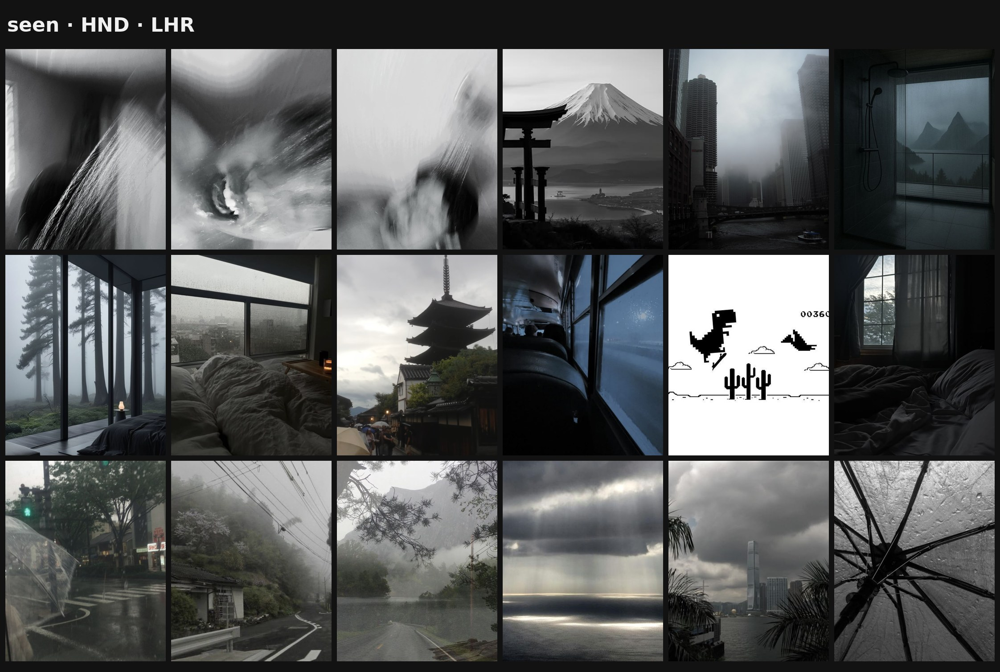

| | | |
|---|---|---|
| 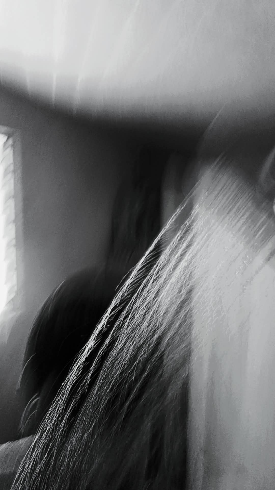 | 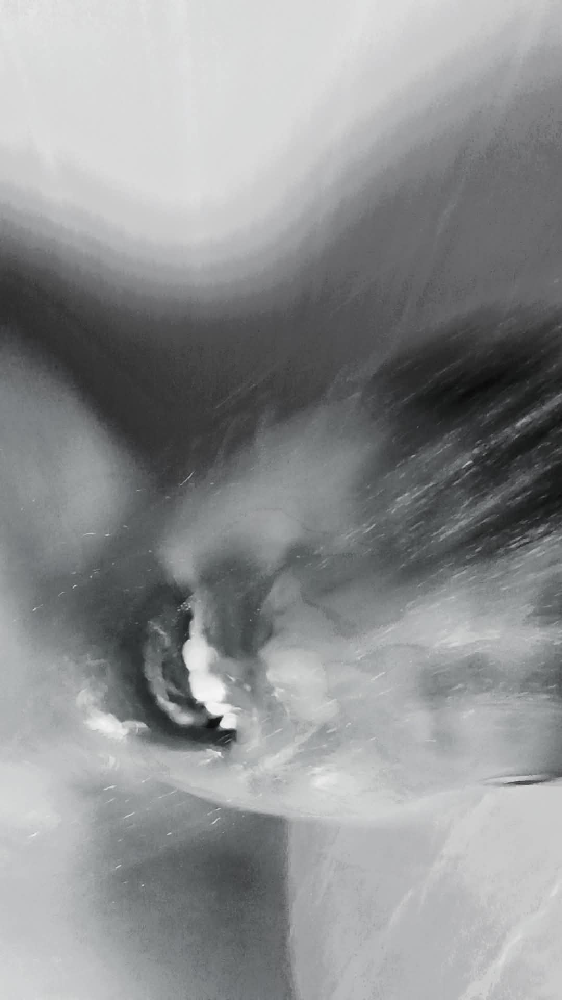 | 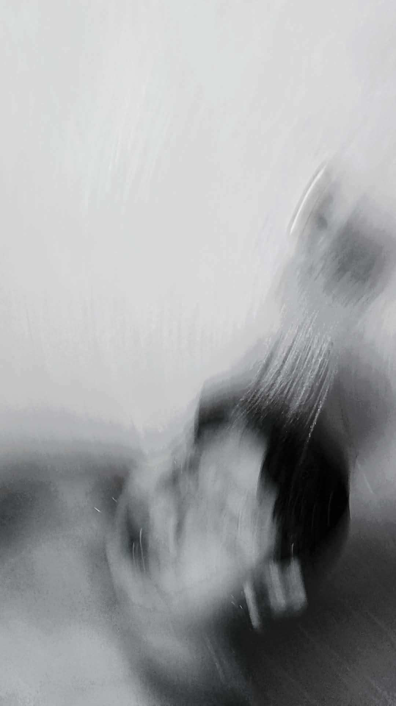 |
| 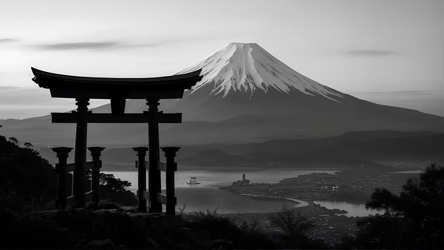 | 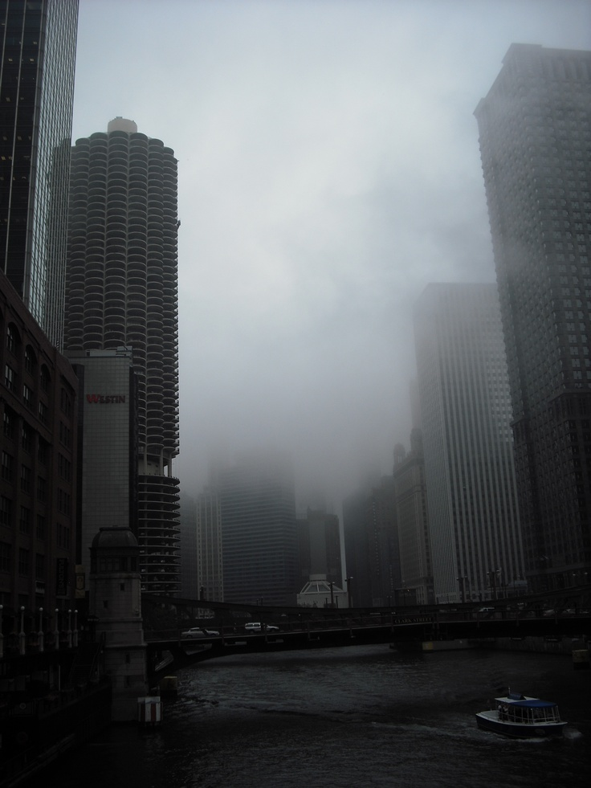 | 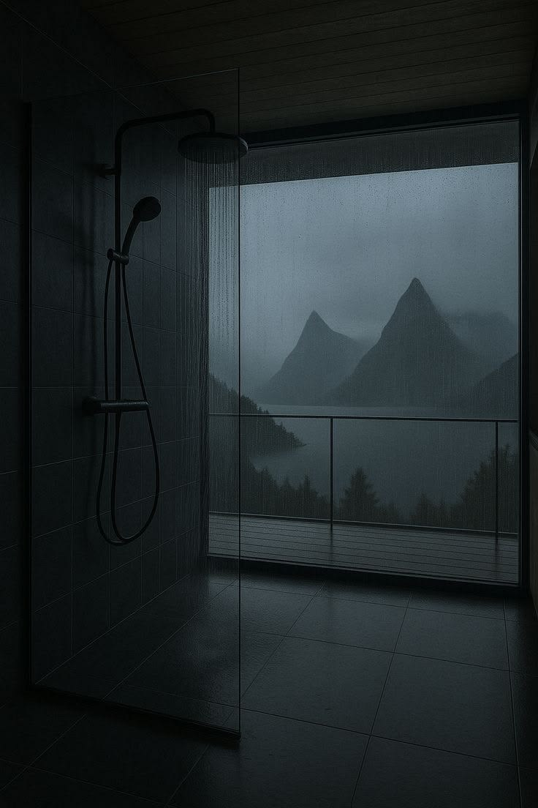 |
| 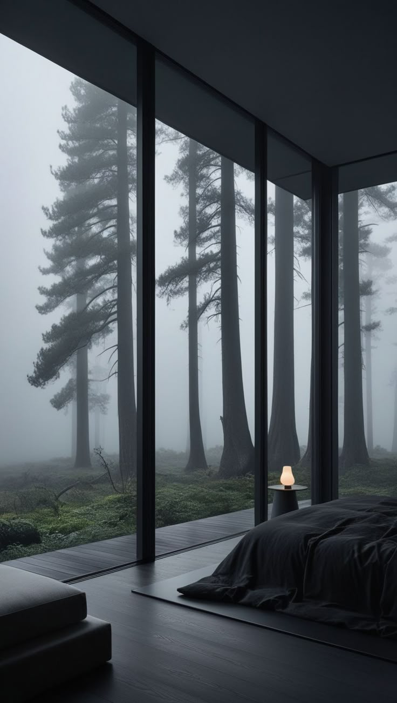 | 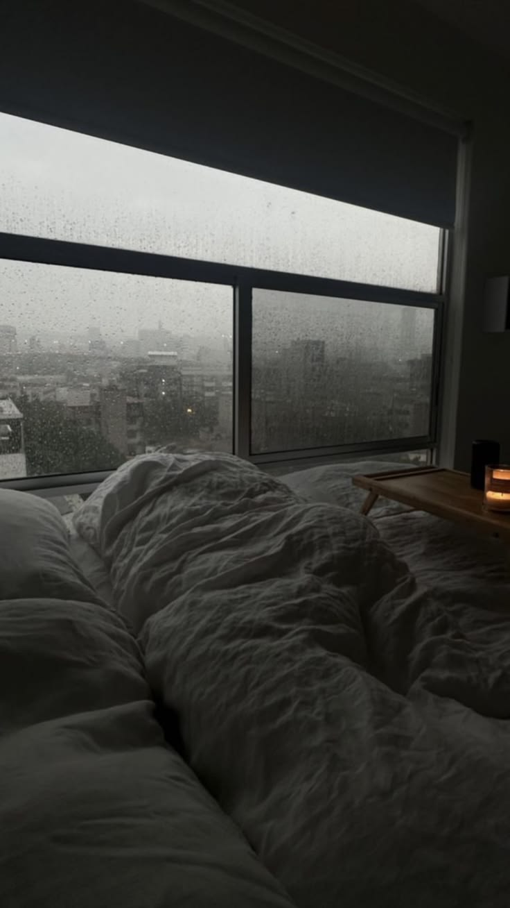 | 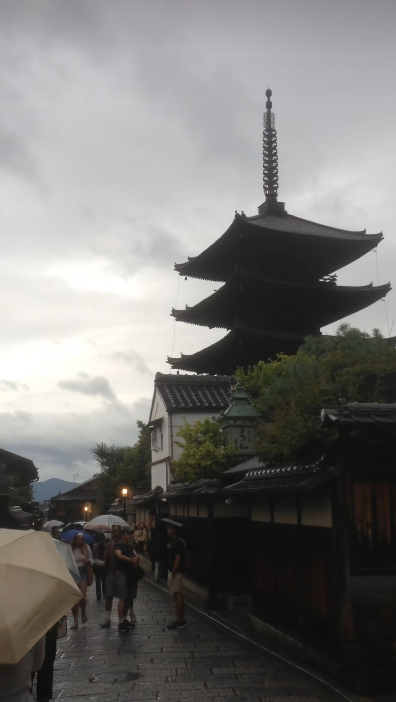 |
| 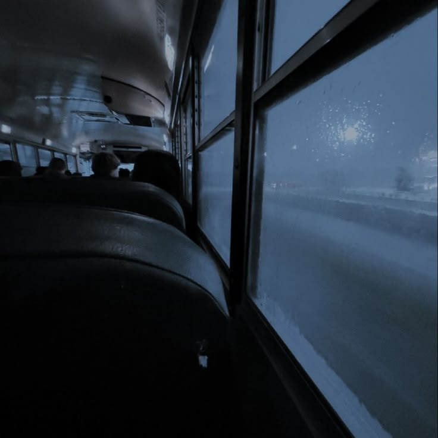 | 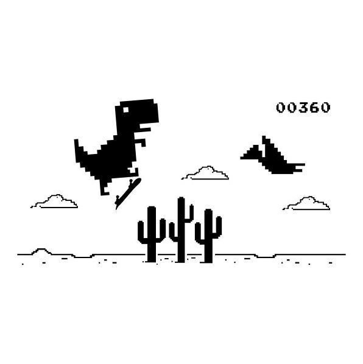 | 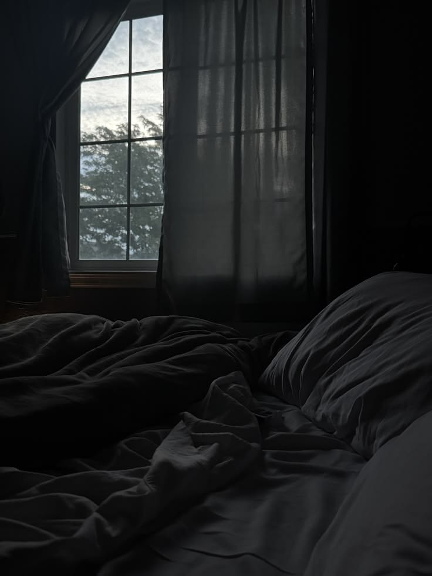 |
| 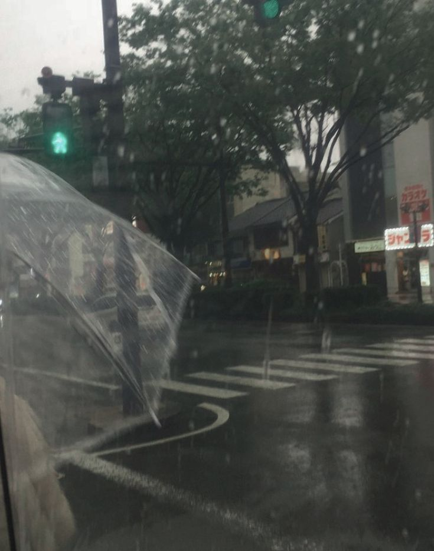 | 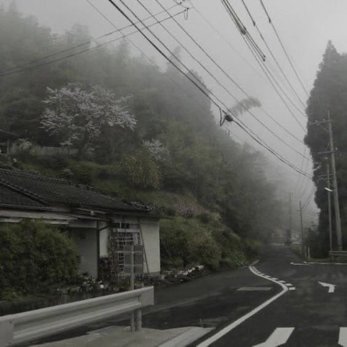 | 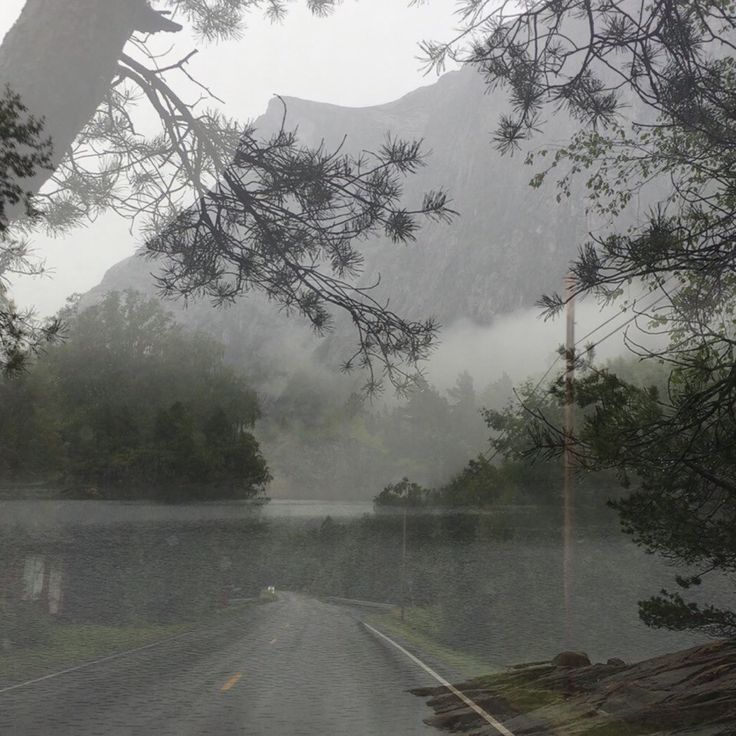 |
| 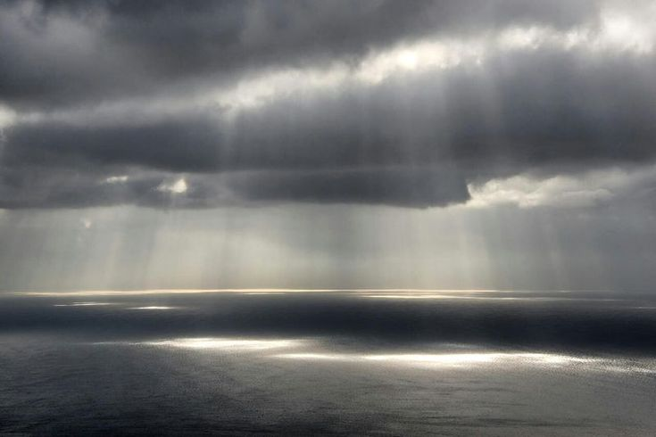 | 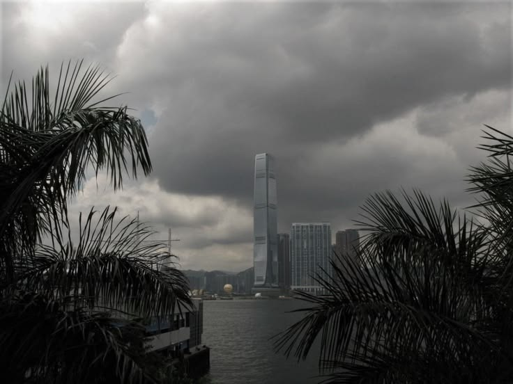 | 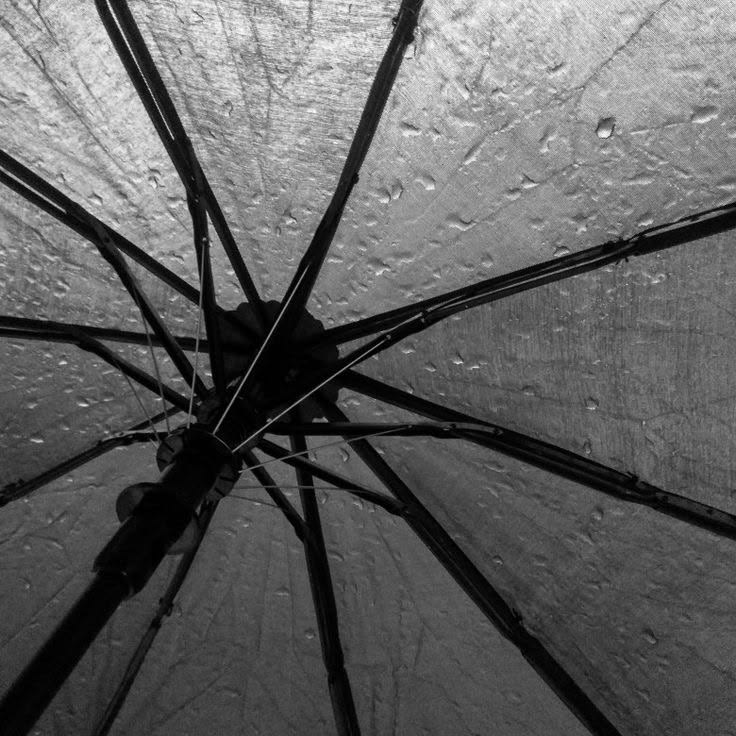 |
